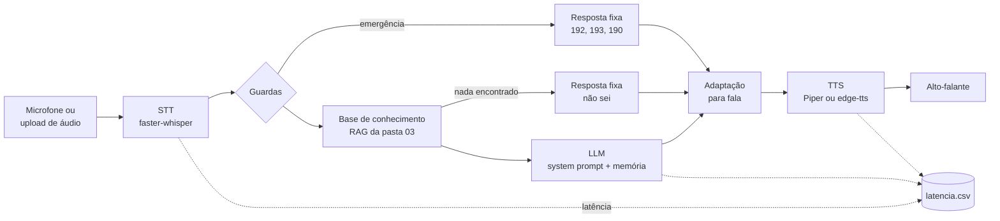

# 02 PLN: Assistente de Voz do EloBairro

Assistente que escuta o morador, entende o pedido com um LLM e responde falando, em português, sem que ninguém precise digitar. Faz parte do EloBairro (veja o [README da raiz](../README.md)) e usa a mesma base de conhecimento do motor RAG da pasta `03-generative-ai`.

**Integrantes:**

| Nome completo | RM |
|---|---|
| Bruno Fernandes Nascimento | 552574 |
| Edgar Lódula de Assis | 565260 |
| Júlia Aben-Athar | 566325 |

> Estado: o código dos módulos, a interface e os scripts de teste estão prontos. STT, LLM e TTS já rodaram com modelos reais. O STT já foi medido com **gravações reais do grupo** e as 30 falas das conversas estão gravadas; o LLM ainda não foi medido com a base real e o TTS ainda não tem as notas dos avaliadores. A seção [Estado e checklist](#estado-e-checklist) diz o que foi verificado e o que falta.

## Problema, persona e ODS

- **Persona:** dona Maria, 72 anos, enxerga pouco e tem dificuldade com texto no celular. Quer saber que horas a UBS abre e o que levar, e prefere perguntar falando e ouvir a resposta.
- **Problema:** os canais de serviço público dependem de texto, cadastro e linguagem burocrática. Idosos, pessoas com baixa alfabetização e pessoas com deficiência visual ou motora ficam de fora.
- **ODS:** 10 (redução das desigualdades) e 16 (instituições eficazes e acessíveis).

## Arquitetura



Cada etapa é um módulo separado, com contrato em [interfaces.py](interfaces.py), então qualquer um pode ser trocado sem reescrever o resto.

| Etapa | Onde | Opções |
|---|---|---|
| Captura de áudio | [app.py](app.py) | microfone ("gravar") e upload de arquivo, com aviso de consentimento antes do primeiro uso |
| STT | [stt/](stt/whisper_stt.py) | faster-whisper `base` ou `small` (variável `STT_MODEL`) |
| Guardas e memória | [llm/assistente.py](llm/assistente.py) | emergência e "não sei" sem passar pelo LLM; últimos 6 turnos de histórico |
| LLM | [llm/provedores.py](llm/provedores.py) | Ollama (local), OpenAI, Groq ou Gemini (nuvem), por `LLM_PROVIDER` |
| Base de conhecimento | [llm/base_rag.py](llm/base_rag.py), [componentes.py](componentes.py) | RAG da pasta 03 (padrão, `BASE_CONHECIMENTO=rag`): corpus oficial de SJC, embeddings e5-large, top-3, abstenção por evidência fraca. A base fictícia `llm/base_stub.py` só entra com `BASE_CONHECIMENTO=stub` (testes) ou, com aviso no log, se o RAG não carregar |
| Adaptação para fala | [adaptacao_fala/](adaptacao_fala/adaptar.py) | sem markdown e emoji, frases curtas, números, siglas, valores, datas e horas por extenso |
| TTS | [tts/](tts/__init__.py) | Piper (local) ou edge-tts (nuvem), por `TTS_ENGINE` |
| Orquestração e latência | [pipeline.py](pipeline.py) | mede STT, LLM+RAG, adaptação, TTS e total por turno |

### Comportamentos de segurança (não dependem do LLM obedecer)

- **Emergência** (por exemplo "socorro", "infarto", "dor no peito"): resposta fixa mandando ligar para 192, 193 ou 190.
- **Sem contexto:** se o RAG não achar nada, o LLM nem é chamado. A resposta fixa diz que não tem a informação e encaminha para o órgão competente. Assim ele não consegue inventar endereço, horário ou valor.
- **Continuação:** a pergunta anterior só entra na busca se a fala parecer continuação ("e", "mas", "então", "isso", "lá"...) e dividir uma palavra com a conversa. Assim, um pedido fora do tema não herda o contexto do assunto anterior e cai na guarda acima.
- **Silêncio ou ruído:** se a transcrição vier vazia, o assistente pede para repetir.
- **System prompt:** define o papel (serviços públicos do bairro), o tom (simples, acolhedor, frases curtas) e os limites (recusar fora do tema, não dar diagnóstico nem parecer jurídico). Está em [llm/assistente.py](llm/assistente.py).

### Por que RAG

As informações do domínio (horários de UBS, documentos para segunda via, benefícios) mudam e precisam ser confiáveis. Com RAG, o conteúdo fica numa base que pode ser atualizada sem retreinar nada, o LLM responde só com trechos recuperados, e cada resposta pode ser rastreada até uma fonte. Fine-tuning exigiria dados e GPU, e deixaria a informação congelada no modelo. Colocar todo o conteúdo no prompt não cabe quando a base crescer.

### Nuvem ou local

| Etapa | Padrão no `.env.example` | Motivo |
|---|---|---|
| STT | local (faster-whisper `small`) | a **voz do usuário não sai do computador**, o que é o dado mais sensível |
| LLM | Ollama local, `qwen2.5:1.5b` (nuvem opcional) | local protege a pergunta; empata em qualidade com o `3b` e leva metade do tempo em CPU |
| TTS | Piper (local) | empatou nas notas com o edge-tts, é 2× mais rápido e não envia o **texto da resposta** à Microsoft |

**Escolha final:** Whisper `small`, `qwen2.5:1.5b` e Piper, justificada pelas medições de qualidade e latência (veja [Testes](#testes-e-métricas) e as seções 6.5 e 9 do relatório). São os padrões do `config.py`; o `.env.example` da raiz pode sobrescrevê-los. Quando algum serviço de nuvem está ativo, a tela de consentimento avisa o que é enviado.

## Modelos, versões e licenças

Versões e licenças dos pacotes foram consultadas no PyPI em 17/11/2026. Os modelos têm licença própria, por isso a coluna "conferir".

| Componente | Versão | Licença | Observação |
|---|---|---|---|
| faster-whisper | 1.2.1 | MIT | pacote de inferência |
| Pesos Whisper `base` e `small` | convertidos para CTranslate2, baixados no primeiro uso | MIT (OpenAI Whisper) | conferir o cartão do modelo usado |
| edge-tts | 7.3.1 | LGPL-3.0 | usa o serviço online do Microsoft Edge: conferir os termos de uso do serviço |
| piper-tts | 1.8.0 | GPL-3.0-ou-posterior | motor local |
| Voz Piper `pt_BR-faber-medium` | n/d | CC0 (dataset, segundo o cartão da voz) | voz sintética pronta, sem clonagem |
| LLM `qwen2.5:1.5b` (padrão) e `qwen2.5:3b`, via Ollama | Ollama 0.40.16 | conferir | o 3B usa a licença Qwen Research (restrita a uso não comercial): confirmar no cartão do modelo, assim como a do 1.5B |
| OpenAI, Groq e Gemini (opcionais) | API | termos do provedor | enviam o texto da pergunta |
| gradio | testado com 5.50.0; `requirements.txt` aceita >=5, <6 | Apache-2.0 | |
| jiwer | 4.0.0 | Apache-2.0 | WER |
| fastembed | 0.7.4 (testado) | Apache-2.0 | embeddings do RAG da pasta 03 |
| `intfloat/multilingual-e5-large` (ONNX, via fastembed) | baixado no primeiro uso (~2,2 GB) | MIT (conferir o cartão do modelo) | recuperação do RAG |
| requests | 2.34.2 | Apache-2.0 | |
| python-dotenv | 1.2.4 | BSD-3-Clause | |

Não clonamos nenhuma voz. Só usamos vozes sintéticas prontas.

## Como executar

Testado no **Python 3.13** em Windows 10 (faster-whisper, piper-tts, edge-tts e gradio funcionaram); o 3.11 e o 3.12 também devem servir. O `requirements.txt` fixa `av<17`, porque o PyAV 19 quebra o `faster-whisper` 1.2.1 (erro `metadata_errors`). Em máquina sem GPU, o `faster-whisper` roda em CPU com `int8`. O Google Colab com GPU T4 também serve.

```bash
cd 02-pln-voz
python -m venv .venv
.venv\Scripts\activate          # Windows; no Linux/macOS: source .venv/bin/activate
pip install -r requirements.txt
cp ../.env.example ../.env      # edite: LLM_PROVIDER, LLM_MODEL, LLM_API_KEY, STT_MODEL, TTS_ENGINE
```

**LLM local:** instale o [Ollama](https://ollama.com) e baixe o modelo, `ollama pull qwen2.5:1.5b` (o padrão; para comparar, também `ollama pull qwen2.5:3b`). No Windows também funciona o pacote portátil `ollama-windows-amd64.zip`, sem instalador: extraia, rode `ollama serve` e depois `ollama pull`.
**LLM em nuvem:** coloque `LLM_PROVIDER=openai` (ou `groq`, `gemini`) e a chave em `LLM_API_KEY` no `.env`. O `.env` não é versionado.
**Voz Piper (necessária com o padrão, que usa o Piper):** baixe a voz nesta pasta.

```bash
python -m piper.download_voices pt_BR-faber-medium
```

Abrir a interface:

```bash
python app.py
```

Na primeira execução com o RAG, o índice do 03 é construído e guardado em cache (`03-generative-ai/rag/retriever/.cache`, fora do git): levou cerca de 6 minutos em uma CPU de 2 núcleos e exige baixar o modelo e5-large. Depois disso a busca leva cerca de 0,1 s. Sem rede ou sem `fastembed`, o app avisa no log e usa a base fictícia, cujas respostas não são oficiais.

Depois abra http://127.0.0.1:7860, aceite o aviso e fale ou envie um áudio.

Para testar só a interface, sem modelos (STT, LLM e TTS simulados):

```bash
python app.py --demo
```

Os testes automáticos e as medições do relatório estão em [testes/README.md](testes/README.md):

```bash
python -m unittest discover -s testes -v
```

## Testes e métricas

| Componente | Teste mínimo | Métrica | Script | Resultado |
|---|---|---|---|---|
| STT | 20 áudios, 3 vozes, 5 com ruído | WER (`jiwer`) | `testes/avaliar_stt.py` | **20 gravações reais do grupo** (3 vozes, 5 com ruído): WER global `base` 0,183 e `small` 0,150 a 0,175 (o `small` varia entre rodadas por causa de um áudio, o `stt_04`); latência 1,44 s e 5,09 s no Codespace (AMD EPYC 7763, 2 vCPUs). Com vozes sintéticas tinha sido 0,114 e 0,066 |
| LLM | 30 perguntas (5 de continuação, 5 fora do escopo) | % corretas e % de recusas adequadas | `testes/avaliar_llm.py` | **Base real (RAG do 03), código final, CPU de 2 vCPUs:** `qwen2.5:3b` e `qwen2.5:1.5b` acertaram 19 de 23 (82,6%) pela revisão assistida por IA (automático: 91,3% e 87,0%); recusas fora do escopo 5 de 5 e abstenção sem dado 2 de 2 nos dois; latência de 55,4 s (3b) e 29,7 s (1.5b) por chamada. Fuga (10 conversas, 3b): 10 de 10 trocas de assunto barradas. Antes de corrigir a regra de continuação, o 3b tinha 73,9% (`evidencias/antes_da_correcao/`). Histórico com a base fictícia em `evidencias/base_ficticia/` |
| TTS | 10 respostas, 3 avaliadores | naturalidade e clareza (1 a 5) | `testes/avaliar_tts.py` | avaliação cega por 6 pessoas em 3 duplas, **uma nota geral por áudio** (1 a 10, convertida para 1 a 5; naturalidade e clareza não separadas): `edge-tts` 4,30 e Piper 4,26, empate. Clareza objetiva pelo Whisper: WER 0,055 (`edge-tts`) e 0,097 (Piper). Síntese média: Piper 1,13 s, `edge-tts` 2,31 s |
| Ponta a ponta | 10 conversas de 3 turnos | latência por etapa e total | `testes/avaliar_e2e.py` | **30 gravações reais, 10 conversas**, Codespace de 2 vCPUs. **A (local: Whisper `base` + `qwen2.5:1.5b` + Piper):** total médio 17,8 s (STT 1,5 s, LLM+RAG 14,6 s, TTS 1,7 s); 34,5 s nos turnos que chamam o LLM. **B (padrão: `small` + `3b` + edge-tts):** 45,1 s (STT 5,2 s, LLM+RAG 38,4 s, TTS 1,5 s); 64,3 s nos turnos com LLM. O `base` derrubou 3 conversas por erro de transcrição de siglas (6 de 20 turnos sobre o tema em "não sei"); o `small`, 1 de 20 |
| Comparação | `base` contra `small` (STT), dois LLMs e dois TTS | qualidade e latência | os mesmos scripts | feita de forma preliminar nos três; repetir com dados reais |

Resultados em `evidencias/` (CSV e resumo em Markdown). As medições preliminares com áudios sintéticos ficam separadas em `evidencias/sintetico/`. Foram feitas em um Intel Core i5-6300U (4 threads) com 16 GB de RAM, sem GPU, e valem para esse equipamento. As medições de STT com gravações reais, de latência de 1,44 s e 5,09 s, foram feitas em um GitHub Codespace (AMD EPYC 7763, 2 vCPUs, 7,9 GB de RAM, Linux, sem GPU), não no i5: a latência vale para aquela máquina, e o WER praticamente não depende dela. Vozes sintéticas são mais limpas que pessoas reais, e o WER real foi de fato maior. Detalhes e análise em [relatorio/relatorio.md](relatorio/relatorio.md).

## Ética, segurança e LGPD

- **Consentimento:** a interface só libera o uso depois de o usuário marcar que leu o aviso (a voz é gravada e processada, o que sai do computador e o que não sai).
- **Retenção mínima:** o áudio do usuário é apagado logo depois de virar texto, e só as 5 últimas respostas sintetizadas ficam em disco (pasta `saida/`, fora do git). O log de latência guarda só números.
- **Nuvem:** o áudio nunca é enviado. Com LLM em nuvem, o texto da pergunta é enviado ao provedor, e com edge-tts o texto da resposta é enviado à Microsoft. A tela de aviso informa isso, e pede para não dizer nome completo, CPF, endereço ou dados de saúde.
- **Limites:** recusa fora do tema, não dá diagnóstico nem parecer jurídico, encaminha emergência (192, 193, 190) e diz "não sei" em vez de inventar.
- **Sem voz clonada:** só vozes sintéticas prontas.
- **Áudios de teste:** são gravações do próprio grupo, feitas com consentimento de quem falou, e não são apagadas pelos scripts de teste.
- **Viés do STT:** o script calcula o WER por falante, ruído, faixa etária e sotaque. Com as gravações do grupo só deu para comparar voz e ruído: as três pessoas têm de 18 a 25 anos e sotaque paulista, então não há variação de idade nem de sotaque, e idosos (a persona) não estão representados. Detalhes na seção 7 do relatório.

## Estado e checklist

Legenda: [x] feito e verificado, [~] código escrito, mas ainda não verificado com modelo real ou no navegador, [ ] a fazer.

- [~] Captura por microfone e upload de áudio (interface verificada só em modo demonstração, e o microfone não foi gravado no navegador)
- [x] STT em português (módulo separado), medido com faster-whisper `base` e `small` em 20 gravações reais do grupo (WER global 0,183 e 0,150 a 0,175) e verificado antes com áudios sintéticos
- [x] LLM com system prompt (papel, tom, limites), executado com `qwen2.5:3b` e `qwen2.5:1.5b` via Ollama; erros analisados em `evidencias/llm_resultados.csv`
- [x] Memória da conversa (perguntas de continuação), coberta por testes
- [x] Base de conhecimento: RAG da pasta 03 integrado (`llm/base_rag.py`) e avaliado com 30 perguntas e dois LLMs (82,6% pela revisão assistida por IA)
- [x] Adaptação para fala (frases curtas, sem markdown e emoji, números e siglas legíveis), coberta por testes
- [x] TTS em português do Brasil: Piper e edge-tts geraram áudio (10 respostas em cada) e foram avaliados por 6 pessoas em 3 duplas, de forma cega (nota geral: empate). Limitação: naturalidade e clareza não foram avaliadas separadamente
- [~] Interface mostra transcrição e resposta em texto, com o áudio, verificada em modo demonstração
- [x] Latência por etapa e total, medida pelo pipeline (um turno real com Whisper e TTS verificado)
- [x] LGPD: consentimento, retenção mínima (verificado: o áudio de entrada é apagado depois da transcrição), recusa fora do tema (guarda barrou 5 de 5 perguntas, com a base provisória) e sem voz clonada
- [~] LGPD: análise de viés do STT feita por voz e por ruído; por faixa etária e sotaque não é possível (as três vozes têm de 18 a 25 anos e sotaque paulista) e idosos não estão representados (relatório, seção 7)
- [x] Scripts e dados de teste (STT, LLM, TTS, ponta a ponta), com 82 testes automáticos. Ferramentas prontas para quando os dados chegarem: `testes/organizar_audios.py` (converte e confere as gravações), `testes/tts_cego.py` (avaliação cega do TTS) e `relatorio/gerar_pdf.py` (PDF do relatório)
- [x] Executar os testes com dados reais: STT (20 áudios), LLM (30 perguntas, 2 modelos, 10 conversas de fuga), TTS (6 avaliadores) e ponta a ponta (10 conversas, 30 gravações, 2 configurações)
- [x] Comparar duas opções em um componente: `base` contra `small` (STT, 20 gravações reais), `3b` contra `1.5b` (LLM, base real) e Piper contra `edge-tts` (TTS, avaliação cega): empate nas notas, com diferenças de latência e de privacidade
- [x] README com arquitetura, modelos, versões e licenças
- [~] Relatório em PDF: texto, ODS, evidência do problema (IBGE), referências e diagrama prontos (`relatorio/figuras/arquitetura.png`); `python relatorio/gerar_pdf.py` gera o PDF final quando não houver mais `[PREENCHER]` (hoje restam os que dependem das gravações, das notas do TTS, da avaliação do LLM com a base real e do vídeo)
- [ ] Vídeo de até 5 min: conversa de 3 turnos com continuação e recusa

## Limitações conhecidas

- O RAG herda os limites do 03: cobre 33 páginas da Prefeitura de SJC e tem falsa abstenção conhecida ("O que o PAIF faz?", cosseno 0,835 contra o limiar 0,84).
- As 30 perguntas de teste foram reescritas com fatos do corpus real e medidas com dois LLMs. As respostas esperadas são palavras-chave, e a revisão que corrige a correção automática foi assistida por IA, com leitura de cada resposta contra a página de origem; uma amostra das notas foi conferida por um integrante do grupo.
- A correção automática do LLM confere palavras-chave, uma aproximação. O grupo pode corrigir na coluna `acerto_manual`.
- A guarda de emergência usa uma lista de palavras, então frases que fujam dela vão para o LLM.
- A regra de continuação compara só as 3 primeiras letras das palavras, então pode casar por coincidência ("prefeito" com "preciso") e tratar como continuação uma fala que mudou de assunto. Uma fala só com palavras genéricas ("E onde eu faço isso?") conta sempre como continuação. A regra é lexical e foi ajustada com os mesmos casos usados para medir (10 de 10 barrados), então o resultado é otimista. Ela pode recusar continuações legítimas com vocabulário novo, e a continuação ainda pode trazer o trecho errado (1 de 10 conversas).
- Os dois LLMs avaliados erram números em perguntas de contagem (q19: 16 e 14 UBS, e a página diz 40) e o `3b` se contradisse em uma resposta de sim ou não (q20). A guarda do 03 (cosseno 0,84) gera falsa abstenção com sinônimos (q21). A correção automática por palavras-chave superestima: a revisão derrubou 2 acertos do 3b. A revisão é assistida por IA, e uma amostra das notas foi conferida por um integrante do grupo.
- A latência por chamada ao LLM com a base real foi de 55,4 s (3b) e 29,7 s (1.5b) em CPU de 2 vCPUs. No ponta a ponta, 17,8 s em média na configuração local e 45,1 s na padrão; nos turnos que chamam o LLM, de 34,5 s a 64,3 s. É incompatível com um assistente de voz: é preciso GPU (Colab T4), API de nuvem ou menos contexto.
- A síntese não é em streaming: a fala só começa quando a resposta inteira está sintetizada. Sintetizar a primeira frase antes do resto reduziria o tempo.
- Os números de STT e TTS vêm de um único computador (CPU de 4 threads, sem GPU) e, no STT, de vozes sintéticas. O STT errou siglas do domínio nas medições preliminares (o `base` transcreveu "UBS" como "B.S.").
