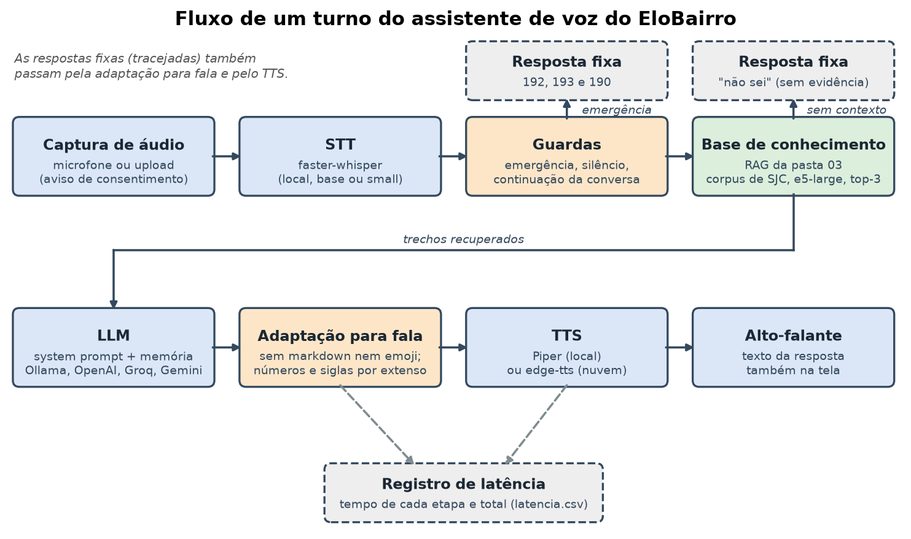

# Assistente de Voz do EloBairro

**Disciplina:** Processamento de Linguagem Natural e Chatbots (PLN), Global Solution 2026.2, FIAP (CitizenTech)

| Nome completo | RM |
|---|---|
| Bruno Fernandes Nascimento | 552574 |
| Edgar Lódula de Assis | 565260 |
| Júlia Aben-Athar | 566325 |

**Repositório:** https://github.com/juliaathar/global-solution-2026.2 (pasta `02-pln-voz`)  
**Vídeo (até 5 min):** [PREENCHER: link]  
**Data:** 19/11/2026

> **Como usar este esqueleto.** Cada seção tem um bloco "Escrever" com o que o enunciado pede, um texto "Já temos" apoiado no que existe no repositório, e marcadores `[PREENCHER: ...]` para o que só o grupo sabe ou só os testes mostram. Apague os blocos "Escrever" antes de exportar. As tabelas de resultado entram sozinhas depois que os scripts de `testes/` rodarem (veja `relatorio/README.md`). Escrevam a conclusão com as próprias palavras.

---

## 1. Introdução: problema e persona

> **Escrever:** a persona atendida, o problema que o assistente resolve e por que a voz é o canal certo. Cite fontes (dados, notícias ou relatos) que sustentem o problema.

**Persona.** Dona Maria, 72 anos, enxerga pouco e tem dificuldade com texto no celular. Quer saber que horas a UBS abre e o que levar, e prefere perguntar falando e ouvir a resposta.

**Problema.** Os canais de serviço público dependem de texto, cadastro e linguagem burocrática. Idosos, pessoas com baixa alfabetização e pessoas com deficiência visual ou motora ficam de fora. O assistente permite perguntar por voz sobre serviços do bairro (UBS, CRAS, segunda via de documentos, problemas na rua) e ouvir a resposta em linguagem simples.

**Evidência do problema.** Os números abaixo são do IBGE, consultados em 18/11/2026.

| Dado | Valor | Fonte |
|---|---|---|
| Pessoas com 15 anos ou mais que não sabem ler e escrever (2025) | 4,9%, cerca de 8,4 milhões de pessoas | [IBGE, PNAD Contínua Educação 2025](https://agenciadenoticias.ibge.gov.br/agencia-noticias/2012-agencia-de-noticias/noticias/47221-analfabetismo-fica-abaixo-de-5-em-2025-mas-8-4-milhoes-ainda-nao-sabem-ler-e-escrever) |
| Taxa de analfabetismo entre pessoas com 60 anos ou mais (2024) | 14,9%, cerca de 5,1 milhões de pessoas | [IBGE, PNAD Contínua Educação 2024](https://agenciadenoticias.ibge.gov.br/agencia-noticias/2012-agencia-de-noticias/noticias/43699-indicadores-educacionais-avancam-em-2024-mas-atraso-escolar-aumenta) |
| População com 60 anos ou mais (Censo 2022) | 32,1 milhões de pessoas, 15,6% da população | [IBGE, Censo 2022](https://agenciadenoticias.ibge.gov.br/agencia-noticias/2012-agencia-de-noticias/noticias/38186-censo-2022-numero-de-pessoas-com-65-anos-ou-mais-de-idade-cresceu-57-4-em-12-anos) |
| Pessoas com deficiência, 2 anos ou mais (2022) | 18,6 milhões, 8,9% dessa faixa etária | [IBGE, PNAD Contínua Pessoas com Deficiência 2022](https://agenciadenoticias.ibge.gov.br/agencia-noticias/2012-agencia-de-noticias/noticias/37317-pessoas-com-deficiencia-tem-menor-acesso-a-educacao-ao-trabalho-e-a-renda) |
| Analfabetismo entre pessoas com deficiência, contra as sem deficiência (2022) | 19,5% contra 4,1% | mesma fonte |

Os dois primeiros números vêm de edições diferentes da pesquisa: a de 2025 foi reponderada com base no Censo 2022, e a de 2024 ainda não, então não devem ser comparados entre si. Nenhum desses indicadores mede o uso de assistentes de voz; eles dimensionam o público para quem uma interface de texto é uma barreira. O dado de pessoas com deficiência visual especificamente não foi levantado.

**Escopo.** O assistente faz parte do EloBairro, que reúne nove disciplinas. Este relatório cobre só o módulo de voz: STT, LLM com memória e base de conhecimento, adaptação para fala e TTS.

## 2. ODS relacionados

> **Escrever:** o ODS e como o assistente contribui. Conferir a redação das metas no texto oficial da ONU antes de citar.

O projeto se relaciona com o **ODS 10** (redução das desigualdades) e o **ODS 16** (paz, justiça e instituições eficazes).

- ODS 10, meta 10.2 (promover a inclusão social, econômica e política de todos, independentemente de idade, deficiência ou condição econômica): o assistente deixa de exigir leitura e digitação para obter informação de serviços públicos, o que inclui quem tem baixa alfabetização, idade avançada ou deficiência visual ou motora.
- ODS 16, metas 16.6 (instituições eficazes, responsáveis e transparentes) e 16.10 (acesso público à informação): as respostas vêm de páginas oficiais da Prefeitura, com a fonte e a data de consulta, e o assistente diz que não sabe em vez de inventar. Isso torna a informação pública mais acessível e rastreável.

## 3. Arquitetura

> **Escrever:** o diagrama, o fluxo de um turno e o papel de cada módulo. Mostre que cada etapa é separada e trocável.

Fluxo de um turno: o áudio (microfone ou arquivo) é transcrito pelo STT; as guardas verificam emergência e se há contexto; o RAG recupera trechos; o LLM responde com o system prompt e o histórico; a adaptação deixa o texto pronto para fala; o TTS gera o áudio. O tempo de cada etapa é registrado.

| Etapa | Módulo | Opções implementadas |
|---|---|---|
| Captura | `app.py` | microfone e upload, com aviso de consentimento |
| STT | `stt/` | faster-whisper `base` e `small` |
| Guardas e memória | `llm/assistente.py` | emergência e "não sei" sem passar pelo LLM; últimos 6 turnos |
| LLM | `llm/provedores.py` | Ollama (local), OpenAI, Groq e Gemini (nuvem) |
| Base de conhecimento | `llm/base_rag.py`, `componentes.py` | RAG da pasta 03: corpus oficial de SJC, embeddings e5-large, top-3 e abstenção por evidência fraca (cosseno < 0,84); a base fictícia só é usada em testes |
| Adaptação para fala | `adaptacao_fala/` | sem markdown e emoji, frases curtas, números, siglas, valores, datas e horas por extenso |
| TTS | `tts/` | Piper (local) e edge-tts (nuvem) |
| Latência | `pipeline.py` | STT, LLM+RAG, adaptação, TTS e total |

## 4. Justificativa das escolhas

> **Escrever:** por que nuvem ou local (custo, latência, privacidade, disponibilidade de internet), por que RAG, e por que cada modelo. A escolha final de modelos deve apoiar-se nas medições da seção 6.

### 4.1 Nuvem ou local

| Etapa | Escolha | Motivo |
|---|---|---|
| STT | local (faster-whisper `small`) | a voz do usuário não sai do computador |
| LLM | local (Ollama), `qwen2.5:1.5b` | mantém a pergunta no computador; em CPU de 2 vCPUs, com o RAG real, levou 29,7 s por chamada contra 55,4 s do `3b`, com a mesma qualidade (seção 6.2) |
| TTS | Piper (local) | escolhido depois da avaliação cega, que empatou (4,26 do Piper contra 4,30 do edge-tts, em escala de 1 a 5): sintetiza em 1,13 s contra 2,31 s e roda no computador, enquanto o edge-tts envia o texto da resposta à Microsoft e precisa de internet (seção 6.3) |

O STT e o Piper rodam no computador, sem custo por uso. O edge-tts não exigiu chave de API neste projeto, mas depende de internet. O LLM local também não tem custo por uso, mas exige cerca de 2 GB de disco para o modelo 3B.

### 4.2 Por que RAG

As informações do domínio (horários, documentos exigidos, benefícios) mudam e precisam ser confiáveis. Com RAG, o conteúdo fica em uma base que se atualiza sem retreinar, o LLM responde só com trechos recuperados, e cada resposta pode ser rastreada até uma fonte. Fine-tuning exigiria dados e GPU e deixaria a informação congelada no modelo; colocar todo o conteúdo no prompt não cabe quando a base cresce. O corpus tem 33 páginas de serviços da Prefeitura de São José dos Campos, consultadas em 17/11/2026 (lista, com hash por página, em `03-generative-ai/corpus/fontes.csv`). Elas foram divididas em 125 trechos por seção, com o título da página no começo de cada um, e a busca é vetorial (embeddings `multilingual-e5-large`, top-3), com abstenção quando o cosseno do melhor trecho é menor que 0,84.

### 4.3 Modelos, versões e licenças

Versões usadas nas medições (a tabela completa, com licenças, está no `README.md` da pasta 02):

| Componente | Versão | Licença |
|---|---|---|
| faster-whisper | 1.2.1 (CTranslate2 4.9.0, PyAV 16.1.0) | MIT |
| Pesos Whisper `base` e `small` | convertidos pelo projeto Systran para CTranslate2 | MIT (Whisper) |
| Piper (`piper-tts`) | 1.8.0 | GPL-3.0 ou posterior |
| Voz Piper `pt_BR-faber-medium` | n/d | CC0 (dataset, segundo o cartão da voz) |
| edge-tts | 7.3.1 | LGPL-3.0, usa o serviço online do Edge |
| LLM `qwen2.5:3b` via Ollama | Ollama 0.40.16 | licença Qwen Research (a conferir no cartão do modelo) |
| LLM `qwen2.5:1.5b` via Ollama | Ollama 0.40.16 | a conferir no cartão do modelo |

## 5. Metodologia dos testes

> **Escrever:** como os dados de teste foram produzidos, para que alguém consiga repetir. Os mínimos do enunciado estão na tabela.

| Componente | Teste mínimo | Métrica |
|---|---|---|
| STT | 20 áudios do grupo, 3 vozes, 5 com ruído de fundo | WER com `jiwer` |
| LLM | 30 perguntas com resposta esperada (5 de continuação, 5 fora do escopo) | % corretas e % de recusas adequadas |
| TTS | 10 respostas avaliadas por 3 pessoas | naturalidade e clareza, de 1 a 5 |
| Ponta a ponta | 10 conversas de 3 turnos ou mais | latência por etapa e total |

- **Áudios do STT:** o enunciado pede 20 áudios gravados pelo grupo. O conjunto final tem 20 áudios de 3 vozes, as dos três integrantes (A, B e C), com 5 áudios com ruído de fundo. Quinze são limpos e vêm das gravações das conversas de teste; os outros cinco (`stt_03`, `stt_07`, `stt_11`, `stt_15` e `stt_19`) foram gravados à parte, com ruído de fundo, todos pela voz A. Os 15 limpos foram escolhidos por uma regra definida antes de ver o WER (os cinco primeiros áudios de cada voz, na ordem das conversas), para não favorecer o resultado. As três pessoas têm de 18 a 25 anos, falam com sotaque paulista e confirmaram o consentimento para o uso das gravações no trabalho. Os arquivos do repositório são WAV de 16 kHz, mono, convertidos dos originais (m4a, WAV e aac do WhatsApp) por `testes/organizar_audios.py`, que também confere nível, duração e ruído de cada gravação: o piso de ruído dos cinco áudios ruidosos ficou entre −34 e −27 dBFS, contra −59 a −44 dBFS nas gravações limpas da voz A. Todas as gravações (as 20 do STT e as 30 das conversas) foram feitas em um celular Samsung Galaxy S25. O ambiente das gravações foi um quarto. A fonte do ruído de fundo dos cinco áudios ruidosos foi um ventilador e um rádio ligados, e a medição do piso de ruído é compatível com isso (−34 a −27 dBFS nos ruidosos, contra −59 a −44 dBFS nas gravações limpas da voz A). Antes das gravações reais, uma medição preliminar com 20 áudios sintéticos (as mesmas 20 frases lidas por três vozes do edge-tts, com ruído branco a 10 dB em 5 deles, `testes/gerar_audios_sinteticos.py`) serviu para validar os scripts. Vozes sintéticas são mais limpas que pessoas reais; esses resultados ficam em `evidencias/sintetico/` e não valem como resultado final.
- **Perguntas do LLM:** 30 perguntas (18 normais, 5 de continuação, 5 fora do escopo e 2 sem resposta na base), com palavras-chave esperadas. Foram escritas a partir da base provisória de 4 textos, que são exemplos fictícios. A correção automática confere palavras-chave; as respostas foram lidas uma a uma, e a revisão manual preliminar (feita com assistência de IA, a conferir pelo grupo) está em `evidencias/llm_resultados.csv`, nas colunas `acerto_manual` e `obs_manual`.
- **Avaliação do TTS:** a avaliação é cega: os 20 áudios foram embaralhados, receberam nomes neutros (`aval_01` a `aval_20`) e foram convertidos para o mesmo formato (WAV mono de 22,05 kHz), então o nome e a extensão do arquivo não revelam o motor (`testes/tts_cego.py`). Foram 6 avaliadores: os 3 integrantes do grupo e um familiar de cada um. Condições de escuta informadas: pelo alto-falante de um celular Samsung Galaxy S25, em uma sala silenciosa. As notas foram dadas em uma escala de 1 a 10 e convertidas para a escala de 1 a 5 do enunciado pela fórmula `nota_1a5 = 1 + (nota − 1) × 4 / 9`, que preserva os extremos (1 vira 1 e 10 vira 5). A conversão é uma suposição de equivalência entre as escalas. Cada dupla deu uma nota geral por áudio, sem separar naturalidade de clareza (limitação). Os resultados estão na seção 6.3.
- **Equipamento das medições:** Intel Core i5-6300U (2 núcleos, 4 threads), 16 GB de RAM, sem GPU, Windows 10, Python 3.13. O STT rodou localmente em CPU com `int8`; o edge-tts usou a internet. O LLM rodou localmente pelo Ollama 0.40.16 (`qwen2.5:3b` e `qwen2.5:1.5b`), em CPU. A rede só foi usada pelo edge-tts.

## 6. Resultados

> **Escrever:** depois de cada tabela, uma análise curta: o que os números mostram, onde o sistema errou e por quê. Use os erros listados nos resumos.

### 6.1 STT

<!-- INCLUIR: evidencias/stt_resumo.md -->

Com as gravações reais, o WER global foi de 0,183 no `base` e de 0,175 no `small` (nesta rodada), contra 0,114 e 0,066 com vozes sintéticas: com pessoas reais o erro é bem maior. A latência média foi de 1,4 s no `base` e de 5,1 s no `small`, medida em um GitHub Codespace (AMD EPYC 7763, 2 vCPUs, sem GPU), não no i5-6300U das medições preliminares; o WER praticamente não depende da máquina, a latência sim.

**O `small` variou entre rodadas em um áudio.** Em uma rodada anterior com os mesmos 20 áudios, o WER global do `small` foi 0,150. A diferença vem de um único áudio, o `stt_04` ("Quem ganhou o jogo ontem?"), que o `small` transcreveu como "O que que eu vou fazer?" (WER 1,2) e, ao repetir, como "O que é que é que é que é?" (WER 1,8). A gravação está normal (nível e ruído comparáveis aos das outras). O Whisper sorteia a decodificação quando a primeira tentativa falha, então um áudio difícil pode mudar de uma rodada para outra. O `base` repetiu exatamente as 20 transcrições. O WER do `small` deve ser lido como um intervalo (0,150 a 0,175) e não como um número único. Sem o `stt_04`, o WER médio por áudio é 0,105 no `small` e 0,161 no `base`.

**Ruído.** Na mesma voz (A), sem o `stt_04`, o WER médio por áudio passa de 0,179 (limpos, n=4) para 0,280 (com ruído, n=5) no `base`, e de 0,081 para 0,189 no `small`: o ruído de fundo moderado aumentou o erro nos dois modelos. Incluindo o `stt_04`, o `small` parece não piorar com ruído (0,191 sem ruído contra 0,189 com ruído), mas isso é efeito desse áudio instável e não robustez. Com 4 a 5 áudios por grupo, o efeito é um indício e não uma medida precisa.

**Onde erra.** Os erros se concentram em siglas e palavras curtas do domínio: "CRAS" virou "CRICE" e "Krais", e "PEVs" virou "peves". Isso importa para o assistente, porque uma sigla errada pode levar a busca a outro serviço. Uma melhoria futura é dar ao Whisper um vocabulário de apoio com as siglas do domínio; não testamos isso para não ajustar o sistema às mesmas frases usadas na medição.

**Medição preliminar com áudios sintéticos.**

<!-- INCLUIR: evidencias/sintetico/stt_resumo.md -->

O `small` errou menos que o `base`: WER global de 0,066 contra 0,114, uma redução de cerca de 42% nos erros, mas levou 6,86 s por áudio contra 2,11 s (cerca de 3,3 vezes mais) nesta CPU, na média das 20 chamadas. O ruído branco a 10 dB não piorou o `base` (0,137 contra 0,138 sem ruído) e piorou pouco o `small` (0,087 contra 0,060), mas são só 5 áudios ruidosos, o que é pouco para concluir. Os erros se concentram em siglas e palavras curtas: o `base` transcreveu "UBS" como "B.S." e "ao BS", e o `small` trocou "como eu aviso" por "com o meu aviso". Como as siglas aparecem em várias perguntas do domínio, isso merece atenção na escolha do modelo.

### 6.2 LLM e diálogo

<!-- INCLUIR: evidencias/llm_resumo.md -->

**Resultado com a base real (RAG do 03) e o código final.** As 30 perguntas foram reescritas com fatos do corpus oficial de SJC (cada palavra esperada foi conferida na página) e rodadas nos dois modelos, em um GitHub Codespace (AMD EPYC 7763, 2 vCPUs, sem GPU). A tabela acima traz a correção automática por palavras-chave e a revisão manual, que prevalece. A revisão foi **assistida por IA**: cada resposta foi lida contra o texto da página de origem (coluna `acerto_manual`), e uma amostra dessas notas foi conferida por um integrante do grupo (as demais notas não foram conferidas por uma pessoa).

| | `qwen2.5:3b` | `qwen2.5:1.5b` |
|---|---|---|
| Corretas, correção automática (23 perguntas) | 21 (91,3%) | 20 (87,0%) |
| Corretas, revisão (23 perguntas) | 19 (82,6%) | 19 (82,6%) |
| Recusas fora do escopo (5) | 5 | 5 |
| Abstenção sem dado na base (2) | 2 | 2 |
| Latência média por chamada ao LLM | 55,4 s | 29,7 s |

Os dois modelos empatam em qualidade, e o `1.5b` leva cerca de metade do tempo. Os erros pela revisão:

- **Nos dois:** `q10` ("E quais ficam no Centro?"): listam ecopontos que não são do Centro. `q19` ("Quantas UBS existem?"): o 3b disse 16 e o 1.5b disse 14, e a página diz 40, então o número certo não foi lido do texto (na primeira rodada o 3b disse 12, o DDD dos telefones). `q21` (tirar árvore de risco): falsa abstenção, porque a consulta com "tirar" (a página diz "remoção") ficou abaixo do limiar de cosseno de 0,84 e o LLM nem foi chamado.
- **Só no 3b:** `q20` ("Dá para tomar vacina até a hora de fechar?"): começa com "Sim", mas a informação que dá (a vacinação encerra uma hora antes) significa que não. Também chamou o Ecoponto Floriano Peixoto de "Florianópolis".
- **Só no 1.5b:** `q11` (leite gratuito): apresenta como requisito ("são beneficiados se") o atendimento preferencial a famílias com responsável desempregado, o que pode afastar famílias que têm direito.

A correção automática superestimou o resultado: a revisão derrubou 2 acertos do 3b (q10 e q20, que contêm a palavra-chave mas erram) e, no saldo, 1 do 1.5b. Com só 23 perguntas, uma resposta vale 4,3 pontos percentuais, então a diferença entre os modelos não é mensurável.

**Antes e depois da correção da continuação.** Na primeira rodada com a base real, o `3b` teve 73,9% pela revisão, e a continuação "E onde eu faço isso?", que é o exemplo do próprio enunciado, caía na guarda de "não sei": "faço" e "fazer" não compartilham as 3 primeiras letras e a regra de continuação não a reconhecia, e a pergunta sozinha só tem palavras genéricas. Passamos a tratar como continuação toda fala com cara de continuação e só com palavras genéricas, e "quanto" passou a ser palavra de pergunta ignorada. Na rodada seguinte o `3b` foi a 82,6%, com as continuações de 3 para 4 de 5. Como o modelo é aleatório (temperatura 0,2) e já vimos de 82,6% a 91,3% entre rodadas, **a melhora de 73,9% para 82,6% não deve ser atribuída só à correção**. O que é determinístico, e coberto por teste, é que a q02 deixou de cair na guarda. Os resultados da primeira rodada estão em `evidencias/antes_da_correcao/`.

**Fuga com o RAG real.** Nas 10 conversas de fuga (`qwen2.5:3b`), as 10 perguntas fora do tema feitas logo depois de uma pergunta do tema foram barradas (nenhuma foi respondida), e as 10 perguntas do tema estavam corretas pela revisão (9 de 10 pela correção automática: a "Para que serve o CRAS?" respondeu certo, mas sem a palavra-chave "família"). A correção da continuação não abriu brecha para troca de assunto. Latência: 20,5 s por chamada.

**Latência e estilo das respostas.** A latência por chamada ao LLM (55 s no 3b e 30 s no 1.5b, sem contar STT e TTS) é incompatível com um assistente de voz para idosos. A causa é o equipamento (CPU de 2 núcleos) e o contexto de 3 trechos; com GPU (Colab T4) ou uma API de nuvem seria bem menor, e reduzir o top-k ou o tamanho dos trechos também ajuda. Esta é a principal limitação prática da medição. Além disso, o prompt manda responder em no máximo 4 frases e sem listas, mas ambos os modelos devolvem listas longas em perguntas de endereço (ecopontos, unidades do CRAS), e o 1.5b mais que o 3b; para a voz isso vira uma fala longa.

**Histórico, base provisória de 4 textos. Guardas, medidas sem LLM.** Primeiro medimos o que não depende do modelo, usando um LLM de teste que só sinaliza quando é chamado e a base provisória de 4 textos:

| Tipo de pergunta | Perguntas | Resultado da guarda |
|---|---|---|
| Fora do escopo | 5 | 5 recusadas pela guarda, sem chamar o LLM |
| Normais | 18 | 18 enviadas ao LLM (nenhuma recusada indevidamente) |
| Continuação | 5 | 5 enviadas ao LLM |
| Sem resposta na base | 2 | 2 enviadas ao LLM: dependem de ele admitir que não sabe |

Esses números valem para a base provisória. Com o RAG real, que terá mais conteúdo, uma pergunta fora do tema pode recuperar algum trecho e passar pela guarda, então o teste precisa ser repetido, e foi (resultados com a base real mais abaixo). A detecção de emergência acertou 5 de 7 frases de teste e errou "meu vizinho está passando mal" e "tem alguém sendo agredido na rua". Ampliamos a lista de padrões depois de ver esses erros, então o resultado atual não é uma medição independente.

**Histórico: resultado com os modelos reais na base provisória** (fictícia, i5-6300U, antes do RAG; não vale para o sistema final). O `qwen2.5:3b` acertou 21 de 23 perguntas que dependem do modelo (91,3%), contra 14 de 23 (60,9%) do `qwen2.5:1.5b`. Na continuação, 4 de 5 contra 2 de 5. O 1.5B inventou informações ("No centro da cidade", "Não há custo para isso") e contradisse a base ao dizer que o EloBairro não gera número de acompanhamento. O 3B errou a q08 (mandou levar "o RG" para tirar a segunda via do RG) e a q17 (disse que certidão de casamento não serve e, na frase seguinte, mandou levar certidão de casamento).

A correção automática marcou a q17 como acerto nos dois modelos, só por conter a palavra-chave. Por isso as respostas foram lidas uma a uma, e a revisão manual preliminar (feita com assistência de IA, a conferir pelo grupo) está na coluna `acerto_manual`.

Os 100% de recusa fora do escopo precisam de ressalva: as 5 recusas vieram da guarda, sem passar pelo modelo. Nas 2 perguntas sem resposta na base, o 3B disse que não sabia nas duas, e o 1.5B inventou "não há custo" em uma (50%). A latência por chamada ao LLM foi de 8,03 s no 3B e 6,22 s no 1.5B.

**Variação entre rodadas (base provisória).** O `qwen2.5:3b` foi medido três vezes nas mesmas 30 perguntas, e a revisão manual deu 91,3% (21 de 23), 87,0% (20 de 23) e 82,6% (19 de 23). Verificamos que os trechos recuperados são idênticos nas três rodadas para as 25 perguntas que dependem do modelo, então a diferença vem do próprio modelo (temperatura 0,2), sobretudo em perguntas de sim ou não sobre a base, em que ele às vezes se contradiz (q14 e q17 na última rodada). Um único percentual, portanto, não é estável. Com a base real a medição foi repetida (duas rodadas do `qwen2.5:3b`, em versões diferentes do código, na seção 6.2), e a variação entre rodadas continua sendo um limite: com o modelo aleatório (temperatura 0,2) e 23 perguntas, diferenças de uma ou duas respostas não são conclusivas.

**Fuga da guarda em perguntas de continuação (base provisória).** No ponta a ponta, um pedido de piada logo depois de uma pergunta sobre a UBS foi atendido pelo LLM. A causa era que, sem contexto para a pergunta sozinha, a busca a unia à pergunta anterior, encontrava o contexto da UBS e a guarda de "não sei" nunca disparava. Montamos 10 casos (uma pergunta do tema seguida de uma fora do tema, em `testes/perguntas_fuga.csv`) e medimos antes e depois:

| Versão | Barrados pela guarda | Recusados pelo modelo | Atendidos fora do escopo |
|---|---|---|---|
| Antes da correção | 0 | 4 | 6 |
| Só a regra de continuação | 7 | 1 | 2 |
| Regra, checagem de assunto e palavras vazias | 10 | 0 | 0 |

Pelo critério automático, no caso do vizinho barulhento o modelo deu um conselho e encaminhou à Defensoria, e isso entrou como "atendido". A regra final reaproveita a pergunta anterior só se a fala parecer continuação (começa com "e", "mas" ou "então", ou usa "isso", "ela", "lá" e palavras parecidas) **e** dividir alguma palavra com a conversa anterior. Os dois furos da versão intermediária foram "E me conta uma piada?", que parecia continuação, e um pedido de poema, que casava com a palavra "sobre" do texto do CRAS. As 5 continuações do conjunto de 30 perguntas seguem funcionando. O custo é que continuações legítimas com vocabulário novo ("E se eu não tiver?") agora recebem "não tenho essa informação". A regra foi ajustada com os mesmos casos usados para medir, então o 10 de 10 é otimista. Falas novas, escritas por outras pessoas, ainda não foram testadas.

### 6.3 TTS

<!-- INCLUIR: evidencias/tts_resumo.md -->

**Notas dos avaliadores.** Os 20 áudios (10 respostas, 2 motores) foram avaliados de forma cega por 6 pessoas, em 3 duplas (cada integrante do grupo com um familiar). Cada dupla deu **uma nota geral** por áudio, de 1 a 10, que foi convertida para a escala de 1 a 5 do enunciado (`1 + (nota − 1) × 4 / 9`). A tabela acima resume o resultado. **Naturalidade e clareza não foram avaliadas separadamente**, e o enunciado pede as duas: isso é uma limitação desta avaliação.

Os dois motores ficaram empatados: nota geral média de 4,30 no `edge-tts` e de 4,26 no Piper, com diferença de 0,04 ponto. Na comparação pareada (a mesma frase nos dois motores), o `edge-tts` teve nota maior em 5 frases, o Piper em 4 e houve 1 empate. Com 10 áudios por motor, notas que já são médias arredondadas (uma imprecisão de até ±0,22 ponto na escala de 1 a 5) e avaliadores que são do grupo e familiares, essa diferença não é conclusiva; a leitura honesta é que as pessoas não distinguiram os dois motores. A dupla 2 deu notas mais baixas ao Piper (4,02 contra 4,29 ao `edge-tts`), e as duplas 1 e 3 não viram diferença relevante.

**Clareza objetiva, medida pelo Whisper.** Como complemento às notas das pessoas, cada um dos 20 áudios de TTS foi transcrito pelo Whisper `small` e comparado ao texto falado (`testes/avaliar_tts_inteligibilidade.py`). Isso mede se uma máquina reconhece a fala, **não** a naturalidade nem a clareza para uma pessoa idosa, e não substitui as notas.

<!-- INCLUIR: evidencias/tts_inteligibilidade.md -->

O `edge-tts` teve WER médio de 0,055 e o Piper de 0,097: os dois são inteligíveis. Parte do erro vem da normalização do texto ("EloBairro" contra "elo bairro", "9-2" contra "nove dois"), então o WER sobrestima um pouco os dois. Os erros reais do Piper são de pronúncia: "buraco" foi entendido como "poraco" e "devagar" como "VADAR".

O que já foi medido é o tempo de síntese neste computador:

| Motor | Respostas | Síntese média (s) | Mínima (s) | Máxima (s) |
|---|---|---|---|---|
| edge-tts (nuvem) | 10 | 2,31 | 1,73 | 4,25 |
| Piper `pt_BR-faber-medium` (local) | 10 | 1,13 | 0,59 | 4,99 |

O Piper foi mais rápido em média e roda sem internet. Os 4,99 s do máximo dele podem incluir a primeira chamada, o que não foi verificado. O tempo do edge-tts depende da rede.

### 6.4 Ponta a ponta e latência

Foram usadas as 30 gravações reais do grupo (10 conversas de 3 turnos: pergunta, continuação e um assunto fora do tema ou sem dado), em duas configurações, em um GitHub Codespace (AMD EPYC 7763, 2 vCPUs, sem GPU). O modelo do LLM foi carregado antes de começar (aquecimento), então o carregamento não entra na conta.

**Configuração A, totalmente local:** Whisper `base`, `qwen2.5:1.5b` e Piper.

<!-- INCLUIR: evidencias/e2e_resumo.md -->

**Configuração B, padrão do projeto:** Whisper `small`, `qwen2.5:3b` e edge-tts (nuvem: só o texto da resposta é enviado).

<!-- INCLUIR: evidencias/e2e_padrao/e2e_resumo.md -->

| | A (local) | B (padrão) |
|---|---|---|
| STT | 1,5 s | 5,2 s |
| LLM + RAG | 14,6 s | 38,4 s |
| TTS | 1,7 s | 1,5 s |
| **Total médio, da pergunta ao início da fala** | **17,8 s** | **45,1 s** |
| Total máximo | 95,9 s | 123,2 s |
| Total nos turnos que chamam o LLM | 34,5 s (14 turnos) | 64,3 s (20 turnos) |
| Total nos turnos resolvidos pela guarda | 3,1 s (16 turnos) | 6,7 s (10 turnos) |
| WER médio das transcrições (30 turnos) | 0,201 | 0,126 |
| Turnos sobre o tema (pergunta e continuação) que terminaram em "não sei" | 6 de 20 | 1 de 20 |

A B leva mais turnos ao LLM (20 contra 14 na A), e por isso o total médio sobe: a A é mais rápida em parte porque recusa mais, e 6 dessas recusas vieram de erros de transcrição. Por tipo de turno, a B leva cerca do dobro do tempo da A (64,3 s contra 34,5 s nos turnos com LLM).

**O STT é o elo mais fraco do fluxo de voz.** Na A, o `base` errou siglas e palavras raras e isso derrubou 3 conversas: "CRAS" virou "cráceo" e "craço", "bueiro" virou "boeiro" e "CREAS" virou "lucrear", e o assistente respondeu "não tenho essa informação" a 6 dos 20 turnos sobre o tema. Como a continuação depende do assunto da pergunta anterior, o erro da primeira pergunta derruba também a segunda. Na B, o `small` acertou essas siglas e só 1 turno sobre o tema terminou em "não sei", com o WER médio das transcrições caindo de 0,201 para 0,126. O custo é a latência do STT (de 1,5 s para 5,2 s) e o LLM maior.

**Fragilidade que sobrou nas duas.** A fala "E posso pedir pelo aplicativo?" (c03-t2) foi transcrita como "**Eu** posso pedir pelo aplicativo?" nas duas configurações. A regra de continuação reconhece a continuação pelo "e" no começo da fala, e o "Eu" fez com que ela deixasse de ser tratada como continuação, e o resultado foi "não sei". A regra depende de o STT acertar uma palavra de uma letra.

**A latência é incompatível com o uso por voz em CPU.** Nos turnos que chamam o LLM, o total vai de 34,5 s (A) a 64,3 s (B), com máximo de 123 s. O STT, o TTS e a adaptação juntos pesam pouco (cerca de 7 s na B); o tempo se concentra no LLM com o contexto de 3 trechos. Para uma pessoa idosa, esperar mais de 30 s por uma resposta falada não é aceitável: é preciso GPU (Colab T4), uma API de nuvem ou menos contexto. Os turnos resolvidos pela guarda (3 a 7 s) mostram o que STT, TTS e adaptação entregam sozinhos.

**Memória.** A configuração B usou cerca de 6,5 GB dos 7,9 GB do Codespace (o `qwen2.5:3b`, o Whisper `small` e o índice do RAG). Uma primeira tentativa terminou de repente, sem erro do programa e com a memória no limite, quando o `qwen2.5:1.5b` ainda estava carregado; atribuímos isso à falta de memória, mas não confirmamos pelo log do sistema. Em uma máquina de 8 GB, só um modelo do Ollama deve ficar carregado por vez.

**Histórico: medição preliminar com falas sintéticas** (feita antes das gravações, com Whisper `small`, Qwen 2.5 3B e Piper; não vale como resultado final). Foram 10 conversas de 3 turnos (30 turnos). As falas planejadas foram sintetizadas com as três vozes do edge-tts, sem ruído, porque as gravações do grupo ainda não existem. A configuração foi 100% local, em CPU: Whisper `small`, Qwen 2.5 3B via Ollama e Piper. O modelo do LLM foi carregado antes de começar, então o tempo de carregamento não entra na conta.

<!-- INCLUIR: evidencias/sintetico/e2e_resumo.md -->

A pergunta levou em média 12,1 s até o início da fala, com máximo de 18,6 s. O STT é a etapa mais pesada (6,5 s, cerca de metade do total), seguido do LLM (4,5 s). A adaptação não pesa e o Piper levou 1,1 s. O LLM foi chamado em 19 dos 30 turnos; nos outros 11, a guarda respondeu na hora. Na primeira medição, antes da correção da fuga da guarda (seção 6.2), o total foi de 14,2 s (máximo de 25,0 s), com o LLM chamado em 24 turnos. A média caiu porque a guarda passou a responder mais turnos sem o modelo, e não porque o sistema ficou mais rápido. Na medição isolada do STT, o `base` levou 2,1 s contra 6,9 s do `small`, então trocá-lo reduziria a espera, ao custo de mais erros de transcrição. Para uma pessoa que espera a resposta falada, 12 s ainda é um tempo longo. A medição com as gravações reais está no começo desta seção (17,8 s em média na configuração local e 45,1 s na padrão, de 34,5 s a 64,3 s nos turnos que chamam o LLM). Esse tempo não é aceitável para a persona, como discutido acima.

**O que a leitura das respostas mostrou (medição sintética).** O script mede tempo, não correção, mas as respostas mostram o comportamento do sistema:

- O pedido de piada ("Obrigado! Me conta uma piada!"), que na primeira medição foi atendido com uma piada, passou a cair na guarda depois da correção (seção 6.2).
- Duas continuações legítimas passaram a receber "não tenho essa informação": "E se eu não tiver?" e "e precisa de mais alguma coisa?". Antes elas recebiam respostas que a base não sustentava ou do assunto errado. A guarda é honesta, mas recusa continuações que usam vocabulário novo.
- Uma continuação ainda trouxe o trecho errado: "E quais documentos eu levo?" depois da pergunta do RG recebeu os documentos da UBS.
- O STT errou palavras nas falas sintéticas ("Como faça a segunda via", "cartão dos SUS para ir ao BS").

### 6.5 Comparação e escolha final

> **Escrever:** a comparação de pelo menos duas opções em um componente (por exemplo Whisper `base` contra `small`), e a decisão com base em qualidade e latência.

Comparação de STT (20 áudios gravados pelo grupo, CPU):

| Modelo | WER global | WER médio por áudio sem o `stt_04` (n=19) | Latência média (s) |
|---|---|---|---|
| faster-whisper `base` | 0,183 | 0,161 | 1,44 |
| faster-whisper `small` | 0,150 a 0,175 (varia entre rodadas) | 0,105 | 5,09 |

O `small` erra menos nos 19 áudios estáveis (0,105 contra 0,161, cerca de um terço a menos), mas custa cerca de 3,5 vezes mais tempo e foi instável em um áudio. O `base` é rápido e repetível, e erra mais em siglas e com ruído. A decisão depende de quanto a latência pesa frente à precisão para a persona. No TTS, as notas dos avaliadores empataram (4,30 do `edge-tts` e 4,26 do Piper), o `edge-tts` foi mais bem reconhecido pelo Whisper (WER 0,055 contra 0,097), e o Piper foi mais rápido (1,13 s contra 2,31 s) e roda sem internet, enquanto o `edge-tts` envia o texto da resposta à Microsoft. Sem diferença de qualidade percebida, a escolha pesa em latência e privacidade.

Comparação de LLM (30 perguntas, base real do RAG, CPU de 2 vCPUs):

| Modelo | % corretas (revisão) | % continuação | % recusas fora do escopo | % abstenção sem dado | Latência por chamada ao LLM |
|---|---|---|---|---|---|
| `qwen2.5:3b` | 82,6% (19 de 23) | 80% (4 de 5) | 100% | 100% | 55,4 s |
| `qwen2.5:1.5b` | 82,6% (19 de 23) | 80% (4 de 5) | 100% | 100% | 29,7 s |

Com a base real e 23 perguntas que dependem do modelo, não há diferença de qualidade mensurável: uma resposta vale 4,3 pontos percentuais. A latência favorece o `1.5b`, que leva cerca de 46% menos tempo. O `1.5b` tende a respostas mais longas e distorceu uma regra (q11), e o `3b` contradisse a si mesmo em uma (q20) e errou um nome (q09 e q10); os dois erraram o número de UBS (q19). Na base fictícia o `1.5b` tinha ficado bem atrás (60,9% contra 91,3%), mas aquele conjunto de perguntas era outro e a base tinha só 4 textos, então os dois resultados não são comparáveis. Em CPU, nenhum dos dois entrega uma resposta em tempo aceitável para voz; a escolha depende do equipamento onde o assistente vai rodar (GPU ou API de nuvem).

**Escolha final.** STT: Whisper `small`. LLM: `qwen2.5:1.5b` via Ollama. TTS: Piper (`pt_BR-faber-medium`). A razão está na conclusão e nas comparações acima. Todas as medições foram feitas em uma CPU de 2 vCPUs; com GPU (Colab T4) ou uma API de nuvem, o `qwen2.5:3b` ou um modelo maior pode ser usado sem mudar o restante do fluxo, e a escolha do LLM deve ser revista, porque a latência deixa de ser o limite.

## 7. Ética, segurança e LGPD

> **Escrever:** cada cuidado do enunciado, como foi implementado e como foi verificado.

| Cuidado | O que o sistema faz | Como foi verificado |
|---|---|---|
| Consentimento | a interface só libera o uso depois de o usuário marcar que leu o aviso, que diz o que é gravado e o que sai do computador | texto do aviso logo abaixo |
| Retenção mínima | o áudio do usuário é apagado logo após a transcrição; só as 5 últimas respostas sintetizadas ficam em disco; o log de latência guarda só números | verificado em um turno real com Whisper e com os dois TTS: o arquivo de áudio de entrada deixou de existir depois da transcrição |
| Uso de nuvem | o áudio nunca é enviado; com LLM em nuvem o texto da pergunta é enviado, e com edge-tts o texto da resposta é enviado; o aviso informa isso | texto do aviso logo abaixo |
| Limites do assistente | recusa fora do tema, não dá diagnóstico nem parecer jurídico, encaminha emergência para 192, 193 e 190 | as 5 perguntas fora do escopo foram recusadas pela guarda (seção 6.2), com a base provisória. Um pedido de piada feito logo depois de uma pergunta do tema chegou a ser atendido pelo LLM; depois da correção da seção 6.2, os 10 casos de fuga foram barrados |
| Alucinação | sem trecho recuperado, o LLM nem é chamado e a resposta diz que não sabe | sem trecho recuperado, a guarda responde que não sabe (5 de 5 perguntas fora do escopo). As 2 perguntas sem resposta na base chegaram ao LLM: o `qwen2.5:3b` respondeu que não sabia nas duas (q29 e q30); o `qwen2.5:1.5b` inventou "não há custo" na q30 |
| Clonagem de voz | só vozes sintéticas prontas | voz `pt_BR-faber-medium` do Piper e vozes do edge-tts |

**Texto do aviso de consentimento.** É o texto que a função `texto_consentimento` de `app.py` gera (não é um print de tela do app em execução). Ele aparece antes do primeiro uso, e o uso só é liberado depois de a pessoa marcar que leu. O aviso muda conforme a configuração: com tudo local ele não cita envio de dados; com o `edge-tts` ele diz que o texto da resposta é enviado à Microsoft; com um LLM em nuvem ele diz também que o texto da pergunta é enviado. O texto abaixo é o da configuração escolhida (Piper e LLM local, sem envio de dados a serviços externos). Com o `edge-tts`, o aviso acrescenta: "**Internet:** o **texto da resposta** é enviado ao serviço de voz `edge-tts` (Microsoft). Seu áudio não é enviado. Não diga nome completo, CPF, endereço ou dados de saúde."

> ### Antes de começar
>
> - Sua **voz será gravada e processada** para responder à sua pergunta.
> - A transcrição é feita **neste computador** (faster-whisper `small`). O áudio é **apagado logo depois** de virar texto.
> - A voz que responde é **sintética**, não é a voz de nenhuma pessoa real.
> - Este assistente **não substitui** médico, advogado ou atendimento de emergência. Em emergência, ligue 192, 193 ou 190.

### 7.1 Análise de viés do STT

> **Escrever:** diferenças de erro entre sotaques, idades e ruído, e o que isso significa para a persona.

Com as gravações do grupo (tabelas na seção 6.1), o WER médio por áudio da voz A foi 0,252 no `base` e 0,307 no `small`, o da voz B 0,040 e 0,000, e o da voz C 0,147 nos dois. A voz A parece pior, mas metade dos seus áudios tem ruído de fundo e um deles é o `stt_04` instável. Só com os áudios limpos e sem o `stt_04` (n=4), a voz A fica em 0,179 no `base` e 0,081 no `small`, na faixa das outras. Com 5 a 10 áudios por voz e frases de 4 a 9 palavras, uma palavra errada muda o WER em 0,1 a 0,3, então **não dá para afirmar que o sistema trate melhor uma voz do que outra**.

**Limite principal.** As três pessoas têm de 18 a 25 anos e sotaque paulista. A análise por faixa etária e por sotaque, que o enunciado pede, **não pôde ser feita**, porque não há variação, e a persona do projeto, uma pessoa idosa, **não está representada**: não sabemos como o STT se comporta com a fala de idosos ou com outros sotaques. Em uso real, é preciso testar com falantes mais velhos e de outras regiões antes de confiar no assistente para esse público. O ruído de fundo foi gravado só pela voz A: a comparação com e sem ruído é feita na mesma pessoa, mas não diz nada sobre o efeito do ruído nas outras vozes. As medições preliminares com vozes sintéticas (Francisca, Antonio e Thalita) mostraram diferença entre vozes que não reflete pessoas reais e não substituem essa análise.

## 8. Limitações e melhorias futuras

> **Escrever:** o que o sistema ainda não faz bem. Seja específico e honesto, e ligue cada limite a uma melhoria.

**Limitações já conhecidas** (revisar com os resultados reais):

- A base de conhecimento é o RAG da pasta 03 (`llm/base_rag.py`) e herda os limites dele: 33 páginas da Prefeitura de uma única cidade e uma falsa abstenção conhecida ("O que o PAIF faz?", cosseno 0,835 contra o limiar de 0,84). Com essa base, os dois LLMs avaliados acertaram 82,6% das perguntas que dependem do modelo (revisão assistida por IA, 23 perguntas), com falsa abstenção (q21) e erros de leitura de número (q19).
- A correção automática do LLM confere palavras-chave, uma aproximação da qualidade real da resposta: ela marcou como acerto uma resposta que se contradizia (q17).
- A regra que decide se uma fala é continuação é lexical e foi ajustada com os mesmos casos usados para medir. Ela pode recusar uma continuação legítima com vocabulário novo ("E se eu não tiver?") e precisa ser validada com falas novas.
- A continuação ainda pode trazer o trecho errado: em 1 das 10 conversas, a pergunta sobre o RG recebeu os documentos da UBS.
- O `qwen2.5:3b` contradiz a base em perguntas de sim ou não (q14 e q17 na última rodada), e o resultado varia entre rodadas (82,6% a 91,3%).
- A latência média de 12,1 s, em CPU e sem GPU, é alta para quem espera uma resposta falada.
- A guarda de emergência usa uma lista de palavras, então frases fora dela seguem para o LLM.
- A síntese não é em streaming: a fala só começa com a resposta inteira sintetizada.
- O STT erra siglas do domínio: nas medições preliminares, o `base` transcreveu "UBS" como "B.S.".
- Os testes de STT cobrem só as vozes do grupo, então sotaques e faixas etárias não gravados não foram avaliados.
- O LLM erra números em perguntas de contagem (q19: 16 e 14 UBS, e o texto diz 40) e pode se contradizer, como "Sim, ..." seguido de uma informação que significa não (q20).
- A guarda de evidência (cosseno mínimo de 0,84, herdada do 03) gera falsa abstenção em perguntas respondíveis escritas com sinônimos: "tirar uma árvore" contra "remoção" (q21).
- As respostas de endereço viram listas longas, contra a regra de 4 frases do prompt, e a adaptação para fala não as encurta, o que vira uma fala longa.
- A regra de continuação compara as 3 primeiras letras das palavras e pode casar por coincidência ("prefeito" com "preciso"), e depende de o STT acertar o "e" do começo da fala: "Eu posso pedir pelo aplicativo?" deixou de ser continuação nas duas configurações.
- Um erro de transcrição de sigla derruba a resposta e também a continuação seguinte (6 dos 20 turnos sobre o tema com o Whisper `base`).
- A revisão das respostas do LLM foi assistida por IA e cobre 23 perguntas; uma amostra foi conferida por um integrante do grupo, e o restante não.
- No STT, as três vozes têm de 18 a 25 anos e sotaque paulista, e há 4 a 5 áudios por grupo comparado.

**Melhorias futuras:**

- Sintetizar e tocar a primeira frase antes do resto, para reduzir o tempo até a fala.
- Usar GPU, ou o Whisper `base`, ou um LLM em nuvem para reduzir a latência.
- Trocar a regra lexical de continuação pela relevância (score) da busca do RAG real, exigir uma relevância mínima dos trechos, fixar a temperatura em 0 e repetir cada teste algumas vezes.
- Testar um LLM maior ou em nuvem, que tendem a contradizer menos a base.
- Passar os termos do domínio (UBS, CRAS, SUS) como dica ao Whisper, para reduzir erros em siglas. É uma hipótese ainda não testada.
- Detecção de voz para falar sem apertar botão.
- Avaliação com mais vozes, em especial de pessoas idosas e de sotaques regionais diversos.
- Dar ao Whisper um vocabulário de apoio com as siglas do domínio (CRAS, CREAS, UBS, PEV, SAMU), que são o principal erro do STT, e medir em frases novas, não nas mesmas do teste.
- Tornar a regra de continuação robusta a erros do STT (por exemplo, considerar continuação uma fala curta sem substantivo novo, mesmo sem o "e" inicial).
- Fixar a temperatura do Whisper em zero para a transcrição ficar reproduzível (o `small` variou em um áudio entre rodadas).
- Acrescentar ao LLM uma guarda de saída como a do 03, que confira números e contradições contra os trechos, para pegar casos como as "16 UBSs".
- Reduzir o tamanho e o número de trechos enviados ao LLM, e usar GPU (Colab T4) ou uma API de nuvem, para baixar a latência de 30 a 55 s por resposta.
- Tratar sinônimos na busca (reranking ou busca híbrida) e revisar o limiar de 0,84, para reduzir falsas abstenções.
- Gravar e testar com falantes idosos e de outros sotaques, que são o público do projeto e não foram cobertos.

## 9. Conclusão

> **Escrever:** com as palavras do grupo, o que foi construído, o que os testes mostraram e o que ficou para depois. Evite repetir a introdução.

> **Rascunho.** Este texto foi redigido com base no que o projeto já tem e deixa os números e os resultados para o grupo. Leiam, ajustem o tom e troquem cada `[PREENCHER]` pelo valor medido. Se algum trecho não refletir o que vocês viram nos testes, reescrevam.

Construímos um assistente de voz em português que recebe a pergunta falada, transcreve, responde com apoio de uma base de conhecimento e devolve a resposta em áudio, mostrando também o texto na tela. O objetivo era dar a quem tem dificuldade com interfaces de texto uma forma de perguntar sobre serviços do bairro falando e de ouvir a resposta em linguagem simples. Cada etapa (STT, LLM com memória e base de conhecimento, adaptação para fala e TTS) é um módulo separado, o que permitiu comparar opções, como o Whisper `base` e o `small` no STT e o Piper e o edge-tts no TTS, sem reescrever o resto do sistema.

Com as gravações reais do grupo (20 áudios, 3 vozes, 5 com ruído), o `base` teve WER global de 0,183 e o `small` de 0,150 a 0,175, com 1,4 s e 5,1 s de transcrição por áudio em CPU; com vozes sintéticas tinham sido 0,114 e 0,066. O `small` erra menos nos áudios estáveis, mas custa cerca de 3,5 vezes mais tempo e foi instável em um áudio, e ambos erram siglas do domínio e pioram com ruído. Na síntese, o Piper levou em média 1,13 s por resposta e o edge-tts 2,31 s. No diálogo, com o RAG real e o código final, o `qwen2.5:3b` e o `qwen2.5:1.5b` acertaram 82,6% das 23 perguntas que dependem do modelo (revisão assistida por IA), com recusas e abstenções adequadas em todas as perguntas fora do escopo e sem resposta, e as 10 trocas de assunto nas conversas de fuga foram barradas. A latência por chamada, de 55,4 s no 3b e 29,7 s no 1.5b em CPU, é a principal limitação prática. Na avaliação cega do TTS por 6 pessoas em 3 duplas, os dois motores empataram (nota geral de 4,30 no `edge-tts` e de 4,26 no Piper, em escala de 1 a 5; naturalidade e clareza não foram avaliadas separadamente), e na medição objetiva o `edge-tts` foi mais bem reconhecido pelo Whisper (WER 0,055 contra 0,097). No ponta a ponta com as gravações reais, a pergunta levou em média 17,8 s até o início da fala na configuração local (Whisper `base`, `qwen2.5:1.5b` e Piper) e 45,1 s na padrão (Whisper `small`, `qwen2.5:3b` e edge-tts); nos turnos que chamam o LLM, de 34,5 s a 64,3 s, e a etapa que mais pesou foi o LLM. O `base` derrubou 3 conversas por erros de transcrição de siglas, e o `small` quase não. Com isso, escolhemos o Whisper `small` no STT, o `qwen2.5:1.5b` via Ollama no LLM e o Piper no TTS. O `small` errou bem menos as siglas do domínio (só 1 de 20 turnos sobre o tema terminou em "não sei", contra 6 de 20 com o `base`), e os 3,7 s a mais pesam pouco perto do LLM. O `qwen2.5:1.5b` empatou em qualidade com o `3b` (82,6% das perguntas pela revisão) e levou cerca de metade do tempo. O Piper empatou nas notas dos avaliadores (4,26 contra 4,30), sintetiza em metade do tempo e roda no computador, o que mantém a voz e o texto da resposta fora de serviços externos, como a LGPD pede.

Duas decisões de projeto pesaram mais do que a escolha dos modelos. A primeira foi manter a transcrição no computador do usuário, de modo que a voz, que é um dado pessoal, não seja enviada a nenhum serviço externo. A segunda foi tratar emergências e ausência de informação com respostas fixas, fora do LLM, em vez de depender só do system prompt para que o modelo recuse ou admita que não sabe. Nos testes, a guarda barrou as 5 perguntas fora do escopo sem chamar o LLM, mas a detecção de emergência falhou em 2 de 7 frases na primeira versão e foi ampliada. O `qwen2.5:3b` disse que não sabia nas duas perguntas sem resposta na base, mas, no ponta a ponta, um pedido de piada feito depois de uma pergunta do tema passou pela guarda e foi atendido. Corrigimos a regra de continuação e os 10 casos de fuga passaram a ser barrados, embora a correção tenha sido ajustada com os mesmos casos da medição.

O trabalho tem limites que precisam ficar claros. A base de conhecimento é o RAG da pasta 03 (corpus de 33 páginas da Prefeitura de SJC), integrado ao assistente de voz por `llm/base_rag.py` e avaliado com 30 perguntas. Os áudios de teste foram gravados por 3 pessoas do grupo, então a análise de viés não cobre sotaques e faixas etárias que não gravamos, em especial a voz de pessoas idosas, que é o público principal. A correção automática das respostas do LLM confere palavras-chave e foi complementada por uma revisão manual das 60 respostas (preliminar, feita com assistência de IA, a conferir pelo grupo). Como a síntese de voz não é em streaming, a fala só começa quando a resposta inteira está pronta.

Como próximos passos, propomos sintetizar e tocar a primeira frase antes do resto para reduzir a espera, testar com mais vozes e sotaques, e alimentar a base de conhecimento com fontes oficiais atualizadas. Para a persona que motivou o projeto, pelas medições o tempo de resposta não é adequado: de 34,5 s a 64,3 s por resposta que usa o LLM em CPU, contra 3 a 7 s nas que a guarda resolve. A voz sintética foi bem avaliada (nota geral de 4,3 em 5) e as recusas fora do escopo foram adequadas em todas as perguntas de teste. Não testamos com pessoas idosas, então a clareza da voz e a facilidade de uso para esse público seguem sem medição.

## 10. Referências

Fontes de dados consultadas em 18/11/2026 (IBGE): as quatro da tabela da seção 1.

Corpus da base de conhecimento: Prefeitura de São José dos Campos, páginas de serviços em https://www.sjc.sp.gov.br/servicos/, consultadas em 17/11/2026 (lista completa, com hash por página, em `03-generative-ai/corpus/fontes.csv`).

Referências técnicas (conferir os links antes de entregar):

- Radford, A. et al. *Robust Speech Recognition via Large-Scale Weak Supervision* (Whisper), 2022. https://arxiv.org/abs/2212.04356
- Wang, L. et al. *Multilingual E5 Text Embeddings: A Technical Report*, 2024. https://arxiv.org/abs/2402.05672
- faster-whisper (SYSTRAN), pacote `faster-whisper` 1.2.1. https://pypi.org/project/faster-whisper/
- piper-tts 1.8.0. https://pypi.org/project/piper-tts/
- edge-tts 7.3.1. https://pypi.org/project/edge-tts/
- jiwer 4.0.0, cálculo do WER. https://pypi.org/project/jiwer/
- Ollama v0.40.16, execução local dos modelos Qwen2.5. https://ollama.com
- Brasil. *Lei nº 13.709, de 14 de agosto de 2018* (Lei Geral de Proteção de Dados Pessoais). https://www.planalto.gov.br/ccivil_03/_ato2015-2018/2018/lei/l13709.htm
- ONU Brasil. *Objetivos de Desenvolvimento Sustentável 10 e 16*. https://brasil.un.org/pt-br/sdgs

## Anexos

- Código e README: https://github.com/juliaathar/global-solution-2026.2, pasta `02-pln-voz`.
- Material de teste: `audios_teste/`, `testes/perguntas_llm.csv`, `testes/planilha_tts.csv`, `testes/conversas_e2e.csv`.
- Resultados brutos: `evidencias/`.
