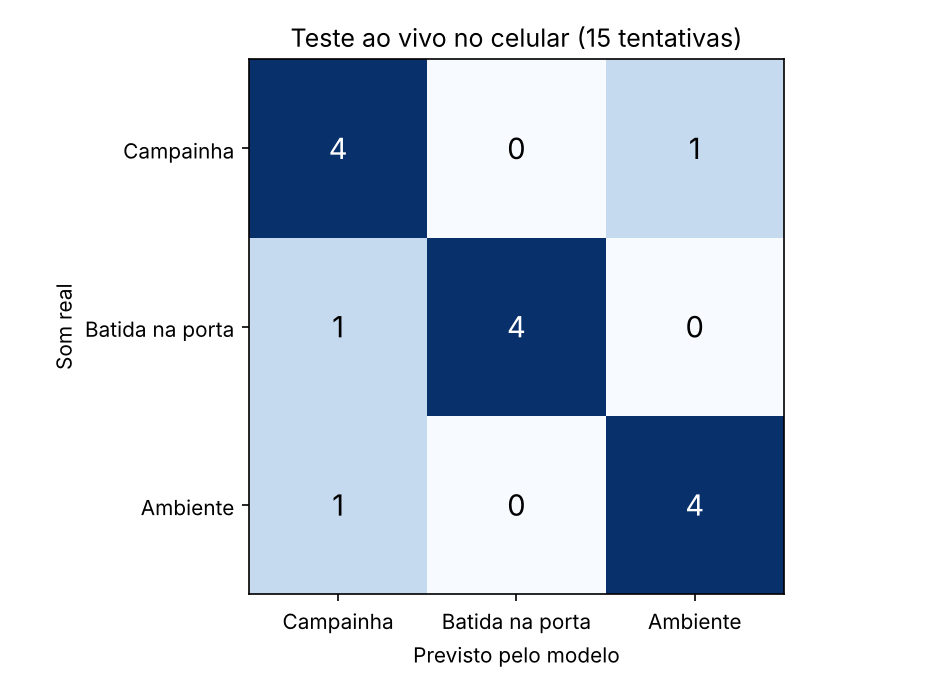

# Teste ao vivo no celular (15 tentativas)

Gerado por `codigo/avaliar.py` em 18/11/2026 22:38.

**Acerto geral: 12 de 15 (80.0%)**

| Classe | Acertos | Total | % |
|---|---|---|---|
| Campainha | 4 | 5 | 80% |
| Batida na porta | 4 | 5 | 80% |
| Ambiente | 4 | 5 | 80% |

## Matriz de confusão

| Real \ Previsto | Campainha | Batida na porta | Ambiente | Incerto |
|---|---|---|---|---|
| Campainha | 4 | 0 | 1 | 0 |
| Batida na porta | 1 | 4 | 0 | 0 |
| Ambiente | 1 | 0 | 4 | 0 |

## Falsos positivos na classe ambiente (som comum que viraria alerta)

- ambiente_5_steps.wav: previsto **Campainha** (0.92)

## Campainha ou batida que não virou alerta

- campainha_2_pattern_20.wav: previsto **Ambiente**

## Tentativas

| # | Som tocado | Real | Previsto | Confiança | Acertou? | Observação |
|---|---|---|---|---|---|---|
| 1 | campainha_1_pattern_20.wav | Campainha | Campainha | 0.85 | ✅ |  |
| 2 | campainha_2_pattern_20.wav | Campainha | Ambiente | 1.00 | ❌ | aparelho pattern_20, que não está no treino |
| 3 | campainha_3_pattern_20.wav | Campainha | Campainha | 0.94 | ✅ |  |
| 4 | campainha_4_pattern_01.wav | Campainha | Campainha | 1.00 | ✅ |  |
| 5 | campainha_5_pattern_18.wav | Campainha | Campainha | 0.99 | ✅ |  |
| 6 | batida_porta_1_door_wood_knock.wav | Batida na porta | Campainha | 1.00 | ❌ | batida forte confundida com campainha |
| 7 | batida_porta_2_door_wood_knock.wav | Batida na porta | Batida na porta | 0.94 | ✅ |  |
| 8 | batida_porta_3_door_wood_knock.wav | Batida na porta | Batida na porta | 0.97 | ✅ |  |
| 9 | batida_porta_4_door_wood_knock.wav | Batida na porta | Batida na porta | 0.92 | ✅ |  |
| 10 | batida_porta_5_door_wood_knock.wav | Batida na porta | Batida na porta | 1.00 | ✅ |  |
| 11 | ambiente_1_mouse_click.wav | Ambiente | Ambiente | 0.98 | ✅ |  |
| 12 | ambiente_2_can_opening.wav | Ambiente | Ambiente | 1.00 | ✅ |  |
| 13 | ambiente_3_vacuum_cleaner.wav | Ambiente | Ambiente | 1.00 | ✅ |  |
| 14 | ambiente_4_cough.wav | Ambiente | Ambiente | 0.94 | ✅ |  |
| 15 | ambiente_5_steps.wav | Ambiente | Campainha | 0.92 | ❌ | passos viraram campainha: falso positivo |
