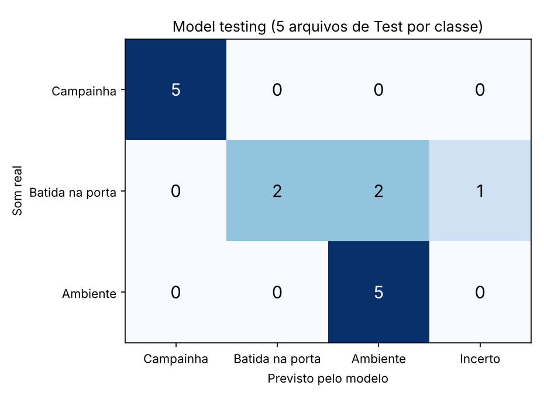

# Model testing (5 arquivos de Test por classe)

Gerado por `codigo/avaliar.py` em 18/11/2026 22:25.

**Acerto geral: 12 de 15 (80.0%)**

| Classe | Acertos | Total | % |
|---|---|---|---|
| Campainha | 5 | 5 | 100% |
| Batida na porta | 2 | 5 | 40% |
| Ambiente | 5 | 5 | 100% |

## Matriz de confusão

| Real \ Previsto | Campainha | Batida na porta | Ambiente | Incerto |
|---|---|---|---|---|
| Campainha | 5 | 0 | 0 | 0 |
| Batida na porta | 0 | 2 | 2 | 1 |
| Ambiente | 0 | 0 | 5 | 0 |

## Falsos positivos na classe ambiente (som comum que viraria alerta)

- Nenhum.

## Campainha ou batida que não virou alerta

- batida_porta.12.wav: previsto **Ambiente**
- batida_porta.09.wav: previsto **Incerto**
- batida_porta.04.wav: previsto **Ambiente**
