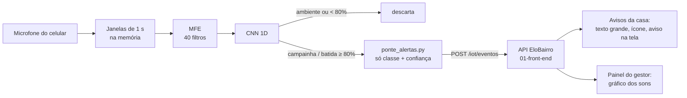
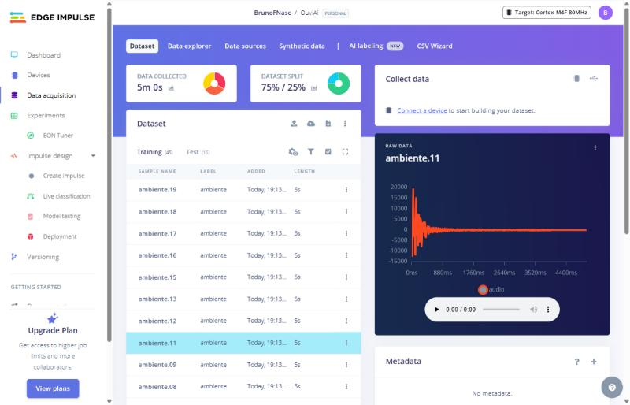
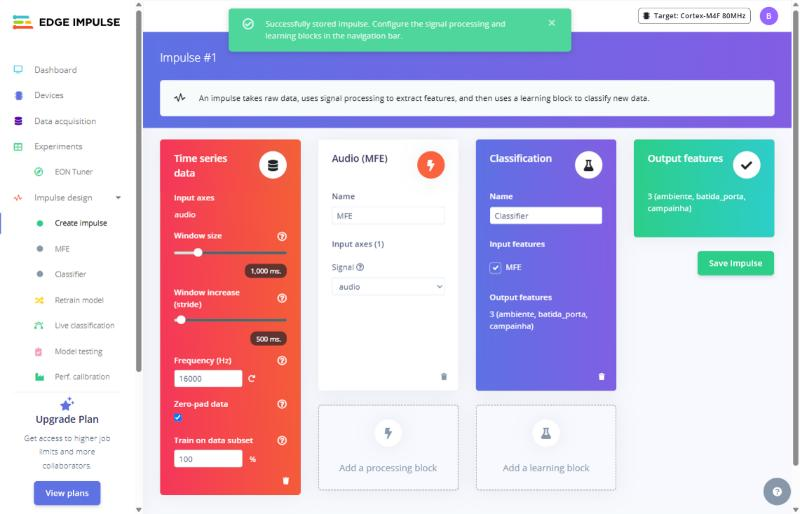
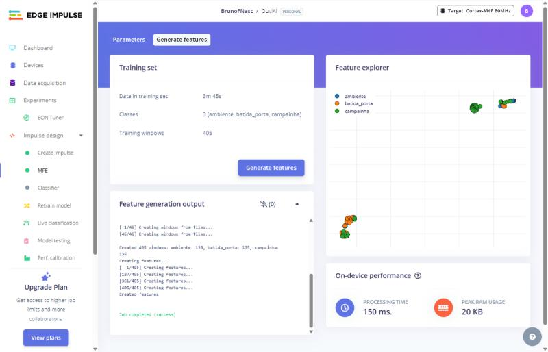
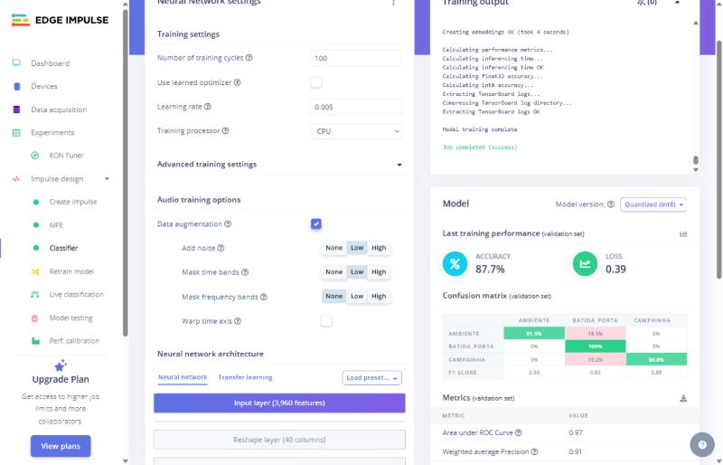
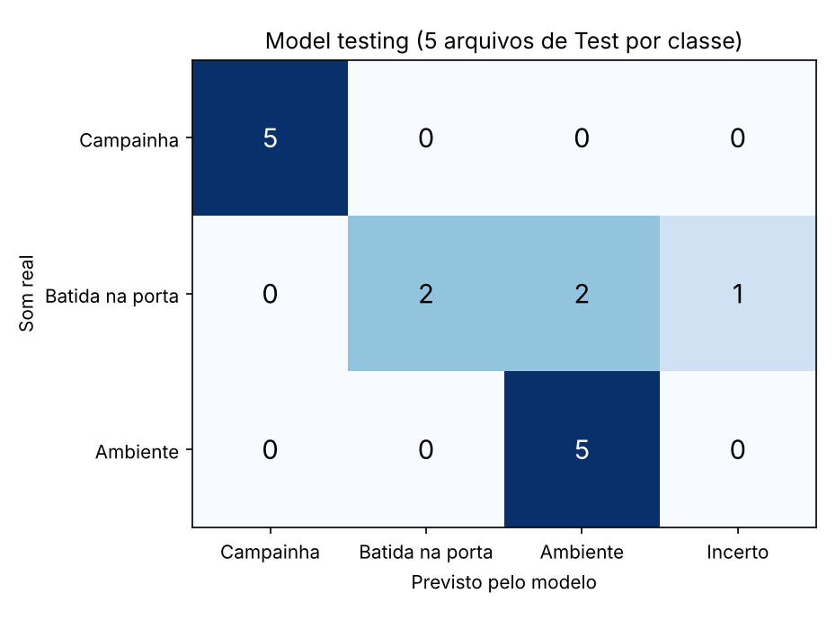
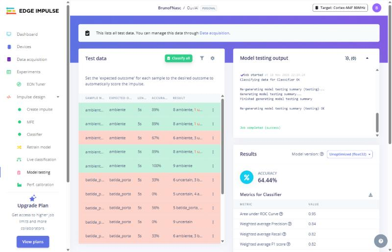
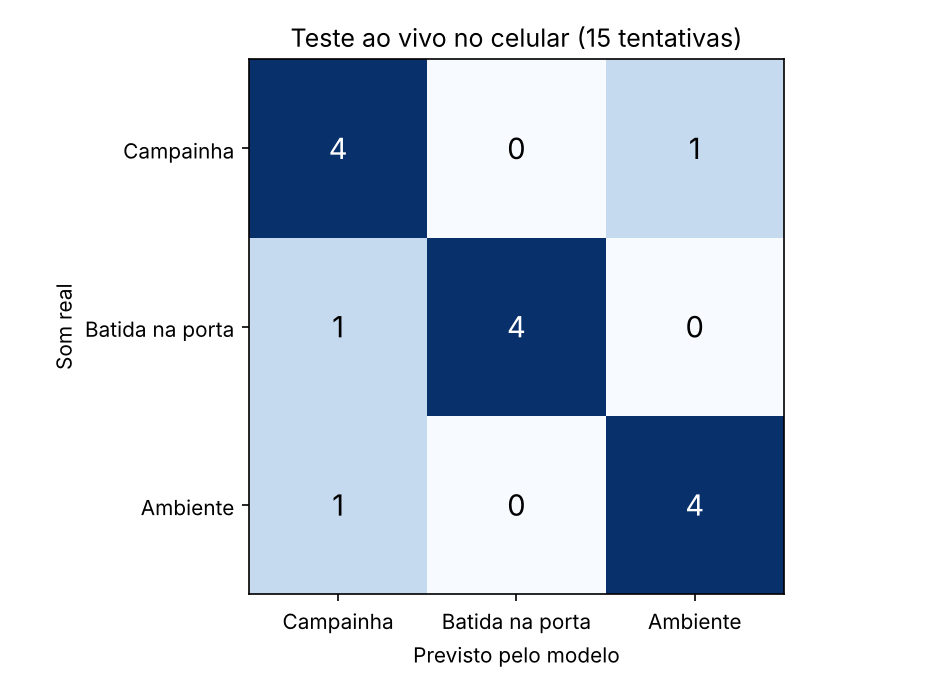
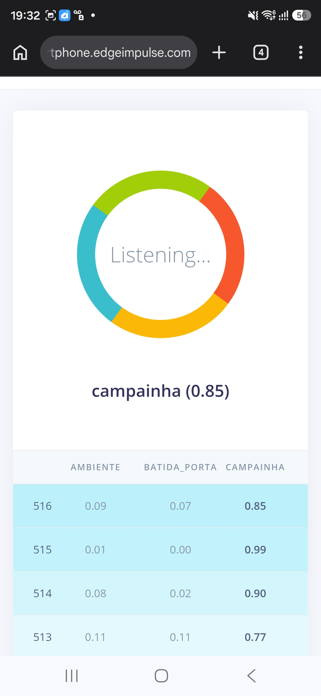
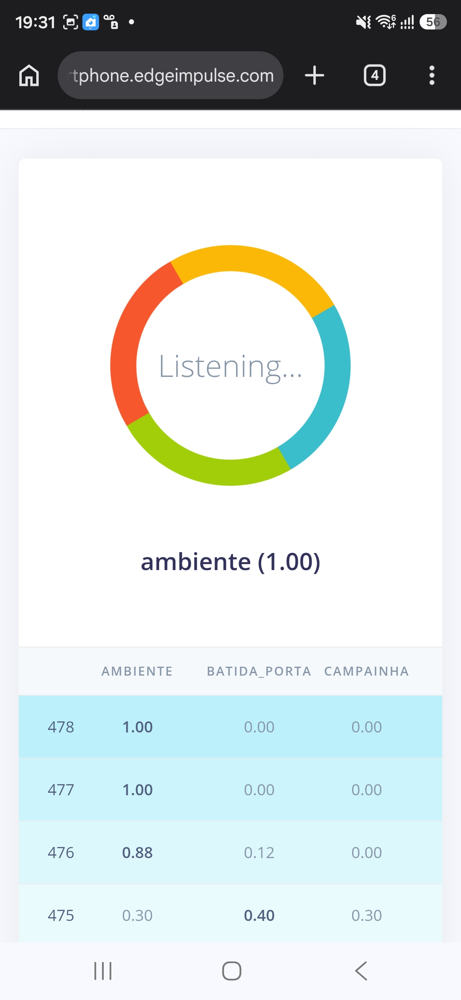

<div align="center">

**FIAP · Engenharia de Software · Global Solution 2026.2**
**IoT e Embedded AI**

<br>

# OuviAí
## Reconhecimento de campainha e batida na porta no celular para pessoas com deficiência auditiva

Módulo de IoT do projeto **EloBairro**

<br>

| Nome completo | RM |
|---|---|
| Bruno Fernandes Nascimento | 552574 |
| Edgar Lódula de Assis | 565260 |
| Júlia Aben-Athar | 566325 |

<br>

São Paulo, novembro de 2026

</div>

<div style="page-break-after: always;"></div>

## Sumário

1. Problema, público e ODS
2. A solução e a integração com o EloBairro
3. Dados
4. Impulse: MFE e CNN
5. Treinamento e validação
6. Model testing
7. Teste ao vivo no celular
8. Falsos positivos e limitações
9. Evolução para notificações e vibração
10. Privacidade e ética
11. Como reproduzir

## 1. Problema, público e ODS

Quem tem deficiência auditiva não ouve a campainha nem alguém batendo na porta. O resultado é perder entregas,
visitas, a equipe de saúde da família e, em situações piores, um vizinho pedindo ajuda. As soluções comerciais
(campainhas com luz, receptores vibratórios) exigem instalar um aparelho para cada fonte de som e custam caro
para famílias de baixa renda.

**Persona.** Seu Antônio, 71 anos, perda auditiva moderada nos dois ouvidos, mora sozinho e não usa aparelho
auditivo o tempo todo. O neto deixou um celular antigo na sala. Ele não escuta quando o agente de saúde bate à porta.

**Público.** Pessoas surdas ou com perda auditiva, idosos que moram sozinhos e as famílias que cuidam deles.
É o mesmo público do EloBairro: pessoas que os canais atuais deixam de fora.

**ODS.**

- **ODS 10 (redução das desigualdades):** um celular usado que a família já tem vira o aviso, sem comprar equipamento.
- **ODS 16 (instituições eficazes e acessíveis):** o alerta chega pelo mesmo app que a pessoa usa para falar com a prefeitura.
- **ODS 3 (saúde e bem-estar), de forma indireta:** não perder a visita da equipe de saúde.

## 2. A solução e a integração com o EloBairro

O celular fica na sala, escutando. Um modelo pequeno (MFE + CNN, treinado no Edge Impulse) roda **no próprio
aparelho** e classifica janelas de 1 s em três classes: `campainha`, `batida_porta` e `ambiente`. Quando reconhece
campainha ou batida com confiança de pelo menos 80%, o EloBairro mostra um aviso grande, com ícone e texto, na
página **Avisos da casa**.



| Peça | Arquivo | O que faz |
|---|---|---|
| Preparação dos dados | `codigo/preparar_audios.py` | converte para 16 kHz, mono, PCM16, 5 s; sorteia 15 Training e 5 Test por classe sem reuso |
| Verificação | `codigo/verificar_dataset.py` | lê cada WAV e confere formato, contagem e duplicatas |
| Envio | `codigo/enviar_edge_impulse.py` | Ingestion API, já na categoria e com o rótulo certo |
| Avaliação | `codigo/avaliar.py` | acerto, matriz de confusão e falsos positivos (Model testing e ao vivo) |
| Ponte | `codigo/ponte_alertas.py` | roda o modelo `.eim` e manda só a classe para a API |
| Recepção | `01-front-end/api/routers/iot.py` | regras de alerta: ignora `ambiente`, confiança < 80% e repetição em menos de 10 s |
| Tela | `01-front-end/web/features/avisos_casa.py` | aviso visual que se atualiza a cada 3 s |

## 3. Dados

O grupo não conseguiu gravar os sons em casa. Por isso o dataset foi montado com **gravações públicas** de
duas bases acadêmicas, todas com sons reais. A origem de cada arquivo está em `dados_audio/creditos_sons.csv`
e o script que monta tudo é `codigo/montar_dataset_publico.py` (sementes fixas: quem rodar de novo obtém os
mesmos arquivos).

| Classe | Origem | Detalhe |
|---|---|---|
| `campainha` | Visualfy, sons de padrão | 4 clipes de cada um de 5 aparelhos com assinatura de campainha |
| `batida_porta` | ESC-50, *door_wood_knock* | batidas reais em portas de madeira, 20 gravações de origem diferentes |
| `ambiente` | ESC-50 (10) + Visualfy, sons indesejados (10) | passos, digitação, relógio, porta rangendo, máquina de lavar; porta batendo, panelas, música, água corrente, palmas |

| Item | Valor |
|---|---|
| Gravações | 20 por classe, 5 s cada (60 no total) |
| Divisão | 15 Training + 5 Test por classe, sorteio com semente fixa, sem reuso |
| Formato | 16 kHz, mono, PCM 16 bits (WAV). O ESC-50 vem em 44,1 kHz e foi convertido; os clipes de 4 s do Visualfy foram completados com silêncio até 5 s |
| Bases | **ESC-50** (K. J. Piczak, ACM Multimedia 2015), CC BY-NC 3.0. **Visualfy** (*An Open-set Recognition and Few-Shot Learning Dataset for Audio Event Classification in Domestic Environments*, Zenodo 3689288, DOI 10.1016/j.patrec.2022.10.019), CC BY 4.0 |

**Como escolhemos as campainhas.** O Visualfy numera os 24 aparelhos de aviso sonoro (pattern_01 a pattern_24)
sem dizer qual é cada um. Olhando o espectrograma de cada aparelho, escolhemos os que têm a assinatura de
campainha: "ding-dong" de dois ou três tons (pattern_01 e 02) e toque de sino com decaimento longo (pattern_18,
19, 20 e 22). Os demais parecem alarmes, timers e melodias eletrônicas e ficaram de fora.

**Sem reuso entre conjuntos.** No ESC-50, uma mesma gravação de origem (`src_file`) nunca aparece em dois
conjuntos (Training, Test ou teste ao vivo). No Visualfy, os clipes do teste ao vivo são outros clipes, e três
deles vêm de um aparelho (pattern_20) que **não aparece no treino**.

**Ambiente difícil de propósito.** Porta batendo, palmas, panelas, passos e digitação são os sons comuns que
mais podem ser confundidos com batida ou campainha; estão no ambiente para o modelo aprender a não dar alarme.

**Rótulos conferidos.** `verificar_dataset.py` conferiu taxa, canais, bits, duração, rótulo e duplicatas:
resultado ✅ em `evidencias/verificacao_dataset.md`. Alguns clipes do ESC-50 chegam perto do volume máximo
(aviso "saturado" no manifesto); foram mantidos porque é assim que a batida forte soa de verdade.

**Figura 1:** Data acquisition: 45 amostras em Training e 15 em Test (75%/25%), 5 min de áudio, 16 kHz.



## 4. Impulse: MFE e CNN

| Bloco | Parâmetro | Valor | Por quê |
|---|---|---|---|
| Entrada | Janela / passo | 1000 ms / 500 ms | uma campainha dura 1 a 2 s; com passo de 0,5 s, cada gravação de 5 s rende 9 janelas |
| | Frequência | 16 kHz | cobre até 8 kHz, onde estão o tom da campainha e o estalo da batida |
| Processamento | **Audio (MFE)** | 40 filtros, quadro de 20 ms, passo de 10 ms, FFT 256, piso de ruído -52 dB | MFE mantém a informação de sons não falados; MFCC é feito para voz e descarta parte dela |
| Aprendizado | **Classification (CNN 1D)** | 2 camadas convolucionais (8 e 16 filtros) com MaxPool e Dropout 0,25 | pequena o bastante para rodar no celular em poucos milissegundos |
| Treino | Ciclos / taxa | 100 / 0,005 | padrão do Edge Impulse para áudio |
| | Validação | 20% do Training | |
| | Aumento de dados | ruído baixo e mascaramento de bandas de tempo | ajuda com o ruído de casa real |

**Figura 2:** Impulse design (janela de 1000 ms, passo de 500 ms, 16 kHz, MFE + Classification, 3 saídas).



**Figura 3:** Generate features: 405 janelas de treino (135 por classe); MFE estimado em 150 ms e 20 KB de RAM no Cortex-M4F.



O que o Feature explorer mostrou: a campainha forma grupos próprios, bem separados. Batida e ambiente se
misturam num grupo central. A causa principal são as **janelas quase silenciosas**: uma batida dura menos de 1 s,
então das 9 janelas de uma gravação de 5 s várias têm só silêncio ou ruído baixo, mas levam o rótulo
`batida_porta`. O mesmo vale para o silêncio que completa os clipes de 4 s do Visualfy.

## 5. Treinamento e validação

| Métrica (validação) | Valor |
|---|---|
| Acurácia | **87,7%** |
| Loss | 0,39 |
| AUC (ROC) | 0,97 |
| Precisão / recall / F1 (média ponderada) | 0,91 / 0,88 / 0,88 |
| No aparelho (Cortex-M4F 80 MHz, int8, EON) | inferência 7 ms, 14,7 KB de RAM, 40,9 KB de flash (+ MFE: 150 ms, 20 KB) |

Matriz de confusão da validação (modelo int8, por janela):

| Real \ Previsto | Ambiente | Batida na porta | Campainha |
|---|---|---|---|
| Ambiente | **81,5%** | 18,5% | 0% |
| Batida na porta | 0% | **100%** | 0% |
| Campainha | 0% | 19,2% | **80,8%** |
| F1 | 0,90 | 0,85 | 0,89 |

As confusões vão quase todas **para** `batida_porta`: é a classe que aprendeu a absorver janelas silenciosas
(seção 4). Campainha e ambiente nunca se confundem entre si.

**Figura 4:** Classifier.



Mudanças feitas: usamos os parâmetros do plano já no primeiro treino, com aumento de dados ligado (ruído baixo e
mascaramento de bandas de tempo baixo).

## 6. Model testing

Classify all nos 5 arquivos de Test de cada classe (15 no total), que nunca foram usados no treino.

O Edge Impulse classifica cada janela de 1 s (9 por arquivo) e marca como *uncertain* a janela com confiança
abaixo de 0,6. Medimos de dois jeitos:

| Medida | Resultado |
|---|---|
| Por janela (o que o Edge Impulse mostra) | **64,4%** |
| Por arquivo: classe com mais janelas, ignorando as incertas (`avaliar.py modelo`) | **12 de 15 (80,0%)** |

| Classe | Acertos por arquivo | Detalhe por janela |
|---|---|---|
| Campainha | 5 de 5 (100%) | 7 ou 8 das 9 janelas certas em todos os arquivos |
| Ambiente | 5 de 5 (100%) | nenhuma janela de ambiente virou campainha ou batida |
| Batida na porta | 2 de 5 (40%) | a maioria das janelas ficou incerta; em 2 arquivos venceu "ambiente" e em 1 tudo ficou incerto |



Detalhe arquivo a arquivo em `evidencias/resultado_model_testing.md` e `evidencias/model_testing.csv`.

**Leitura.** Campainha e ambiente funcionam bem, inclusive sem nenhum falso positivo de ambiente no Test. A batida
é o ponto fraco: os golpes duram frações de segundo e o resto da janela é silêncio, então o modelo fica em dúvida.
Para o uso real isso pesa menos do que parece, porque o alerta dispara quando **qualquer** janela passa do
limiar, e em 3 dos 5 arquivos de batida pelo menos 3 janelas foram reconhecidas como batida. Melhorias possíveis:
janela de 500 ms, cortar o silêncio das gravações antes do treino e mais exemplos de batida.

**Figura 5:** Model testing.



## 7. Teste ao vivo no celular

**Como fizemos.** Abrimos *Run this model* pelo QR code no celular e permitimos o microfone. Os 15 sons do teste
(pasta `dados_audio/teste_ao_vivo/`, 5 por classe) foram tocados no alto-falante do computador, perto do
celular, um por vez. Nenhum deles foi usado no treino nem no Test: são outras gravações de origem do ESC-50
(incluindo sons que o modelo nunca viu, como clique de mouse, lata abrindo, aspirador e tosse) e campainhas
do Visualfy que não foram usadas, três delas de um aparelho que o modelo nunca ouviu. Anotamos a classe que
apareceu na tela e a confiança.

**Resultado: 12 de 15 acertos (80,0%)**, 4 de 5 em cada classe.

| # | Som tocado | Real | Previsto (confiança) | Acertou? |
|---|---|---|---|---|
| 1 | campainha 1 (aparelho novo, pattern_20) | Campainha | Campainha (0,85) | ✅ |
| 2 | campainha 2 (aparelho novo, pattern_20) | Campainha | Ambiente (1,00) | ❌ |
| 3 | campainha 3 (aparelho novo, pattern_20) | Campainha | Campainha (0,94) | ✅ |
| 4 | campainha 4 (pattern_01, outro clipe) | Campainha | Campainha (1,00) | ✅ |
| 5 | campainha 5 (pattern_18, outro clipe) | Campainha | Campainha (0,99) | ✅ |
| 6 | batida em porta de madeira 1 | Batida na porta | Campainha (1,00) | ❌ |
| 7 | batida em porta de madeira 2 | Batida na porta | Batida na porta (0,94) | ✅ |
| 8 | batida em porta de madeira 3 | Batida na porta | Batida na porta (0,97) | ✅ |
| 9 | batida em porta de madeira 4 | Batida na porta | Batida na porta (0,92) | ✅ |
| 10 | batida em porta de madeira 5 | Batida na porta | Batida na porta (1,00) | ✅ |
| 11 | clique de mouse | Ambiente | Ambiente (0,98) | ✅ |
| 12 | lata abrindo | Ambiente | Ambiente (1,00) | ✅ |
| 13 | aspirador de pó | Ambiente | Ambiente (1,00) | ✅ |
| 14 | tosse | Ambiente | Ambiente (0,94) | ✅ |
| 15 | passos | Ambiente | Campainha (0,92) | ❌ |

| Real \ Previsto | Campainha | Batida na porta | Ambiente |
|---|---|---|---|
| Campainha | **4** | 0 | 1 |
| Batida na porta | 1 | **4** | 0 |
| Ambiente | 1 | 0 | **4** |



Planilha em `evidencias/tentativas_ao_vivo.csv` e relatório gerado em `evidencias/resultado_ao_vivo.md`.

**Leitura.** Ao vivo, a batida foi melhor do que no Model testing (4 de 5 contra 2 de 5): olhando a tela
enquanto o som toca, vale a janela em que a batida acontece, e não a média das 9 janelas do arquivo, quase todas
silenciosas. Das 3 campainhas do aparelho que o modelo nunca ouviu (pattern_20), 2 foram reconhecidas. Os 3 erros
foram todos com confiança alta (0,92 a 1,00), o que mostra que o limiar de 80% sozinho não resolve: é preciso mais
dados e a regra de repetição da API.

**Figuras 6 e 7:** tela do celular no *Run this model*, reconhecendo campainha (0,85 a 0,99) e ambiente (1,00).

<p float="left"> </p>

## 8. Falsos positivos e limitações

**Falsos positivos na classe ambiente.** No Model testing, nenhum dos 5 arquivos de ambiente virou campainha ou
batida (nenhuma janela). Na validação, 18,5% das janelas de ambiente foram para batida, quase todas trechos
silenciosos. **No teste ao vivo houve 1 falso positivo em 5:** os **passos** viraram campainha (0,92). Passos têm
batidas curtas e repetidas no chão, um padrão parecido com o de uma campainha de toques; como só havia 2 clipes de
passos no ambiente de treino, o modelo não aprendeu a separar bem. Também houve uma **batida forte confundida com
campainha** (1,00) e uma **campainha que ficou como ambiente**, do aparelho que não estava no treino.

Para o usuário, um falso positivo é um aviso à toa; um falso negativo é perder a visita.
Por isso o sistema combina três defesas, independentes do modelo:

1. `ambiente` nunca gera alerta e não sai do aparelho;
2. só alerta com confiança ≥ 80% (`IOT_LIMIAR`, ajustável);
3. o mesmo som repetido em menos de 10 s conta como um alerta só (uma batida tem 3 ou 4 golpes).

**Limitações.**

- 20 gravações por classe é pouco. O modelo aprende *estas* campainhas e *estas* portas; outra casa precisa de novas gravações.
- **Dados públicos.** O modelo não foi treinado com a campainha e a porta de uma casa brasileira específica.
  Uma campainha de timbre muito diferente (cigarra, campainha musical) pode não ser reconhecida. O próximo passo
  seria completar o dataset com gravações da casa de quem vai usar.
- **Rótulo de campainha inferido.** O Visualfy não nomeia os aparelhos; a escolha dos que são campainha foi feita
  pelo espectrograma e pode incluir algum outro tipo de aviso sonoro com o mesmo padrão.
- **Som tocado pelo alto-falante.** No teste ao vivo os sons saíram de um alto-falante, não de uma porta de verdade,
  o que muda um pouco o timbre e o eco.
- Sons parecidos com batida (armário, martelo do vizinho, louça) continuam sendo o principal risco de falso alarme.
- Com TV alta ou música, a campainha pode ficar abaixo do limiar.
- O celular precisa ficar ligado, na tomada e no mesmo cômodo da porta; o navegador do *Run this model* para de
  escutar se a tela apagar.
- O teste ao vivo teve 15 tentativas, que dão uma ideia do comportamento, não uma medida estatística firme.

## 9. Evolução para notificações e vibração

O protótipo mostra o alerta na tela do EloBairro. Para virar um produto que a pessoa não precisa ficar olhando:

1. **App no celular com o modelo embutido.** Exportar o impulse como biblioteca (WebAssembly ou C++ para Android)
   e rodar dentro do app, em segundo plano, com o celular na tomada. Assim o *Run this model* deixa de ser necessário.
2. **Vibração com padrões diferentes.** Campainha = duas vibrações longas (600 ms, pausa, 600 ms); batida =
   três curtas (200 ms). A API já devolve esses padrões no campo `vibracao_ms` de cada alerta, prontos para a
   função de vibração do Android ou para `navigator.vibrate` num app web.
3. **Notificação no celular da pessoa** (não só no que escuta): a API envia um push (Firebase Cloud Messaging)
   para os aparelhos cadastrados da casa, com ícone e texto grandes.
4. **Relógio inteligente e pulseira:** a mesma notificação vibra no pulso, que é onde a pessoa sente mesmo dormindo.
5. **Luz:** uma lâmpada inteligente da casa pisca numa cor para campainha e noutra para batida.
6. **Microcontrolador dedicado:** o mesmo impulse cabe num ESP32-S3 ou Arduino Nano 33 BLE Sense com microfone,
   ligado na tomada perto da porta, consumindo menos que um celular.
7. **Aprender a casa nova:** botão "isso não era a campainha" que guarda a classe errada (nunca o áudio) para orientar
   novas gravações.

## 10. Privacidade e ética

- **Sem gravar conversas.** Nenhuma gravação foi feita na casa de ninguém: o dataset usa sons públicos do ESC-50
  e do Visualfy, sem fala de pessoas. Num uso real, as gravações de ajuste seriam feitas sem ninguém falando.
- **Processamento no aparelho.** No uso, o áudio fica em janelas de 1 s na memória e é descartado. Nada é gravado.
- **Só a classe sai do aparelho.** A API recebe `{classe, confianca, dispositivo}`, nunca áudio. Eventos de `ambiente` nem são enviados pela ponte.
- **Consentimento da casa.** Quem mora ou visita precisa saber que existe um microfone ligado; sugerimos um aviso
  na porta e um botão de pausa.
- **LGPD.** O áudio de voz é dado pessoal e pode ser sensível. Por isso o desenho evita coletá-lo: a finalidade é
  só reconhecer dois sons. Os dados de treino ficam no projeto do Edge Impulse do grupo e podem ser apagados ao fim da disciplina.
- **Não é equipamento de segurança.** O OuviAí não substitui alarme de incêndio nem detector de fumaça.

## 11. Como reproduzir

Passo a passo completo em [`GUIA_EDGE_IMPULSE.md`](../GUIA_EDGE_IMPULSE.md). Resumo:

```bash
cd 05-iot/codigo
pip install -r requirements.txt
python preparar_audios.py && python verificar_dataset.py
python enviar_edge_impulse.py --enviar          # com EI_API_KEY definida
python avaliar.py modelos                       # planilhas em evidencias/
python avaliar.py modelo && python avaliar.py ao-vivo
python ponte_alertas.py --simular               # com a API do EloBairro no ar
```

Projeto no Edge Impulse: OuviAi (ID 1168410), conta BrunoFNasc.
