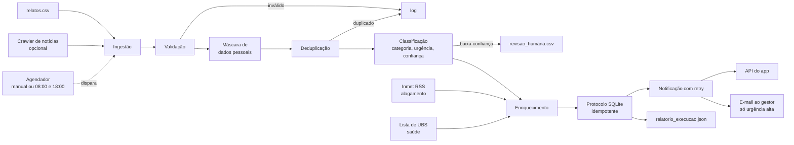

# 06 RPA e IA: robô do EloBairro

Robô que pega os relatos confirmados pelo cidadão (buraco, iluminação, lixo, calçada, alagamento, saúde), valida, mascara dados pessoais, remove duplicados, classifica categoria e urgência, consulta fontes públicas, gera um protocolo e notifica. O que o robô não resolve vai para revisão humana.

**Integrantes:**

| Nome completo | RM |
|---|---|
| Bruno Fernandes | 566325 |
| Edgar Lódula | 565260 |
| Júlia Aben-Athar | 566325 |

## Problema e público
Muita gente não sabe a quem recorrer para um problema do bairro (buraco, poste apagado, alagamento) nem onde fica a UBS mais próxima, e os canais existentes dependem de texto, cadastro e linguagem burocrática. O EloBairro recebe o relato do cidadão por voz, texto ou foto (disciplinas de PLN, visão e front-end) e **este robô é o que acontece depois**: sem ele, cada relato dependeria de alguém da prefeitura ler, conferir se já foi registrado, decidir a prioridade, abrir o protocolo e avisar o gestor. Com ele, isso acontece sozinho, duas vezes ao dia ou sob demanda, e só o que é ambíguo chega a uma pessoa.

Público atendido: idosos, pessoas de baixa renda e pessoas com deficiência, moradoras de bairros com pouca informação disponível (ODS 10 e ODS 16, como no [README da raiz](../README.md)). Para esse público, o protocolo rastreável e o encaminhamento ("a UBS do seu bairro é esta, abre neste horário") valem mais do que um formulário.

## Visão geral do fluxo


## Como executar
Requer Python 3.10+. Instale as dependências (`beautifulsoup4`, `lxml`, `requests`) e rode a partir de `06-rpa/codigo`:

```bash
pip install -r ../requirements.txt
python gerar_dados.py              # dados sintéticos rotulados (125 linhas)
python main.py                     # robô completo (ponto de entrada)
python avaliar.py                  # acerto na amostra sintética e na sugestão de UBS
python avaliar_independente.py     # acerto na amostra escrita à mão (desenvolvimento e teste)
python demonstrar_falha.py         # 9 falhas tratadas, grava evidencias/falha_tratada.txt
python -m unittest discover -s ../testes -v
```

Sem linha de comando: `notebooks/demonstracao.ipynb` roda o fluxo inteiro célula a célula (offline por padrão, também no Colab). Ele é gerado por `python gerar_notebook.py`.

Opcional, para a comparação com ML: `pip install -r ../requirements-ml.txt` e `python avaliar_ml.py`.

## Agendamento da busca
A busca (coleta web, validação, classificação, protocolo e notificação) roda de duas formas, sempre pelo `agendador.py`:

| Modo | Comando | Quando usar |
|---|---|---|
| **Manual** | `python agendador.py agora` | quando a pessoa quiser buscar, na hora |
| **Automático (serviço)** | `python agendador.py servir` | fica rodando e busca nos horários de `RPA_HORARIOS` (padrão `08:00,18:00`, duas vezes ao dia) |
| Ver próximas | `python agendador.py proximas` | mostra as próximas 4 execuções |

Opções: `--horarios 07:30,12:00,19:00` troca os horários; `--sem-noticias` dispensa o crawler de notícias. Cada busca grava uma linha em `saida/historico_execucoes.jsonl` (gatilho manual ou agendado, início, duração, resumo ou erro). Garantias:
- **Uma busca por vez:** um arquivo de lock impede que a manual e a agendada rodem juntas; a segunda é registrada como `ignorada`. Lock esquecido (mais de 1 h) é removido.
- **Repetir não duplica:** o protocolo é idempotente e as cópias de relatos já processados também são reconhecidas.
- **Erro não derruba o serviço:** uma busca que falha vira `status: erro` no histórico e o serviço espera o próximo horário.

**Alternativa com cron do sistema** (em vez de deixar o `servir` aberto). Linux e Mac, `crontab -e`, às 08:00 e 18:00:

```
0 8,18 * * * cd /caminho/para/06-rpa/codigo && python agendador.py agora --gatilho agendado
```

Windows, Agendador de Tarefas (executar uma vez no PowerShell):

```
schtasks /Create /SC DAILY /ST 08:00 /TN "EloBairro busca manha" /TR "cmd /c cd /d C:\caminho\06-rpa\codigo && python agendador.py agora --gatilho agendado"
schtasks /Create /SC DAILY /ST 18:00 /TN "EloBairro busca tarde" /TR "cmd /c cd /d C:\caminho\06-rpa\codigo && python agendador.py agora --gatilho agendado"
```

Teste real do serviço: `evidencias/agendamento.txt` mostra o serviço iniciado às 19:27, a busca disparada às 19:29:00 (gatilho `agendado`, 0 protocolos novos por ser repetição) e a próxima marcada para o dia seguinte. As linhas de cron e `schtasks` estão documentadas, mas não foram executadas.

## Configuração
Tudo por variáveis de ambiente, sem chaves no código. Não há chave de API: o robô usa regras e SQLite, sem LLM. Para ligar o e-mail, copie `.env.example` para `06-rpa/.env` e preencha (o `.env` é lido sem dependências e nunca vai para o git; a senha é uma *senha de app* do Gmail, não a senha da conta).

| Variável | Padrão | Função |
|---|---|---|
| `RPA_ENTRADA` | `dados_sinteticos/relatos.csv` | CSV de entrada |
| `RPA_CONFIANCA_MINIMA` | `0.5` | abaixo disso, vai para revisão humana |
| `RPA_SIMILARIDADE` | `0.85` | limiar de duplicado |
| `RPA_TENTATIVAS` / `RPA_ESPERA_BASE` | `3` / `0.2` | retry com espera exponencial |
| `RPA_API_URL` | vazio | endpoint do app que recebe o protocolo por POST JSON (contrato em `codigo/api_simulada.py`); vazio = sem POST |
| `RPA_SMTP_USUARIO` / `RPA_SMTP_SENHA` / `RPA_EMAIL_DESTINO` | vazio | liga o e-mail ao gestor. Faltando qualquer uma, o canal fica desligado |
| `RPA_SMTP_HOST` / `RPA_SMTP_PORTA` | `smtp.gmail.com` / `587` | servidor SMTP (STARTTLS) |
| `RPA_EMAIL_URGENCIAS` | `alta` | urgências que geram e-mail, para não inundar o gestor |
| `RPA_HORARIOS` | `08:00,18:00` | horários da busca automática (`agendador.py servir`) |
| `RPA_TIMEOUT` | `5` | timeout (s) das chamadas HTTP |
| `RPA_UBS_URL` | lista de UBS de São José dos Campos | página pública raspada |
| `RPA_OFFLINE` | vazio | `1` usa só os snapshots locais (sem rede) |
| `RPA_ESPERA_REQ` | `1` | espera (s) após cada requisição ao site |
| `RPA_USAR_NOTICIAS` | vazio | `1` liga o crawler do Arquivo de Notícias como fonte extra de relatos públicos |
| `RPA_MAX_PAGINAS` | `3` | limite de páginas do crawler |
| `RPA_INMET_URL` / `RPA_INMET_AREA` | feed RSS do Inmet / `Vale do Paraíba Paulista` | feed e mesorregião dos avisos |

## Quadro de temas
Temas da disciplina (BeautifulSoup4, seletores CSS, XPath e webcrawler), mais IA com regras, e-mail, agendamento e resiliência.

| Tema | Onde entra no fluxo | O que resolve |
|---|---|---|
| Web scraping com BeautifulSoup4 e seletores CSS | `coleta_web.extrair_css` (UBS), `coleta_noticias.extrair_css` (cartões `div.noticia-02`), tabela do CDATA em `coleta_inmet` | Lê a lista pública de UBS e os cartões do arquivo de notícias; transforma a tabela HTML dos avisos do Inmet em campos |
| XPath com `lxml` | `coleta_web.extrair_xpath`, `coleta_noticias.extrair_xpath`, `coleta_inmet.extrair_avisos` (`//item` no XML do RSS) | Mesma extração por `starts-with()`, `contains()`, `following-sibling`; lê o XML do feed do Inmet. CSS e XPath devolvem o mesmo resultado nas duas páginas HTML (testado) |
| Webcrawler | `coleta_noticias.rastrear` | Percorre `?pag=1..N` do Arquivo de Notícias de SJC com limite de páginas, espera entre requisições, parada quando a página não traz notícia nova e mantém o já coletado se uma página falhar |
| IA / NLP com regras | `classificador.py`, `coleta_web.sugerir_ubs` | Classifica categoria, urgência e confiança; nos relatos de saúde sugere a UBS pelo nome citado |
| Automação de e-mail (SMTP) | `notificador._enviar_email` | Avisa o gestor por e-mail (`smtplib`, STARTTLS, timeout) dos protocolos de urgência alta; nunca leva o texto do cidadão |
| Agendamento (cron) | `agendador.py` | Busca manual na hora ou automática duas vezes ao dia, com lock e histórico; alternativa com cron ou Agendador de Tarefas |
| Resiliência e orquestração | `main.py`, `notificador.py`, `armazenamento.py`, `coleta_web.baixar` | robots.txt, User-Agent, timeout, retry só para erro transitório (5xx e rede; 4xx não se repete), snapshot local, protocolo idempotente, log e relatório JSON |
| Humano no circuito | `saida/revisao_humana.csv` | Casos ambíguos vão para uma pessoa |

### Por que esta combinação serve a este problema
- **Scraping + XPath + crawler** porque a informação que o cidadão precisa (qual UBS, qual aviso de chuva) está em páginas públicas feitas para ler, não para consumir por programa, e não há API. Cada fonte exigiu uma técnica diferente: lista plana de `<p>` (CSS e XPath, e a divergência entre os dois virou teste), feed XML com tabela HTML dentro do CDATA (XPath para o XML, CSS para a tabela) e arquivo paginado (crawler).
- **Regras em vez de LLM** porque o relato pode ter dado pessoal e o enunciado dá peso a rodar sem chave e sem enviar texto a terceiros. Medimos um modelo de ML contra as regras (veja a seção de evidências): com os dados que temos, as regras ganham.
- **E-mail só para urgência alta** porque o gestor precisa do que é grave, não de cada protocolo; e o e-mail leva só o protocolo, não o texto, para o canal do gestor não virar vazamento.
- **Agendamento duas vezes ao dia e sob demanda** porque o Inmet e as páginas mudam ao longo do dia, e quem opera precisa poder disparar a busca depois de um temporal sem esperar o horário.
- **Revisão humana e idempotência** porque o público é vulnerável: um relato perdido ou um protocolo duplicado tem custo real, e o robô deve preferir pedir ajuda a errar sozinho.

**Por que CSS e XPath na mesma página:** o HTML da prefeitura é uma sequência plana de `<p>` sem id nem classe por unidade. O CSS percorre os parágrafos e agrupa em ordem; o XPath localiza o título pelo texto e lê os irmãos seguintes. Os dois divergiram quando telefone e horário vieram no mesmo `<p>` (UBS Novo Horizonte); a leitura por rótulo (`_campos`) resolveu para ambos.

## Fontes públicas
- [Feed Alert-AS do Inmet](https://apiprevmet3.inmet.gov.br/avisos/rss): RSS, licença "public domain" declarada no feed.
- [Arquivo de Notícias da Prefeitura de SJC](https://servicos.sjc.sp.gov.br/arquivonoticias/arquivo_noticias.aspx): o formulário de busca tem reCAPTCHA e não é usado.
- [Unidades básicas de saúde, Prefeitura de SJC](https://www.sjc.sp.gov.br/servicos/saude/unidades-basicas-de-saude-ubs/unidades-basicas-de-saude/): sem `robots.txt`, HTML estático.

`dados_sinteticos/` guarda snapshots das três fontes (`ubs_sjc_snapshot.html`, `inmet_avisos_snapshot.xml`, `arquivo_noticias_pag1.html` e `pag2`), usados como caminho seguro e nos testes. O snapshot do Inmet tem avisos de 07 a 18/11/2026; depois disso o robô registra um aviso de snapshot desatualizado e trata como sem alerta. O mapa das fontes testadas e descartadas está em `relatorio/mapa_fontes.md`. Os relatos de cidadãos continuam sintéticos.

## Evidências (`evidencias/`)
**Execução e fluxo**
- `relatorio_execucao.json`: execução com 125 linhas (17/11/2026, com rede): 107 protocolos, 14 duplicados, 3 inválidos, 1 em revisão humana.
- `api_simulada.txt`: o robô enviou 107 protocolos por POST a uma API simulada (`codigo/api_simulada.py`, que define o contrato para o front) e a API recebeu os 107. A integração com a API real do `01-front-end` ainda não existe.
- `alerta_inmet.txt`: com data fixa (16/11/2026 12:00) e o snapshot do feed, 3 avisos vigentes para o Vale do Paraíba; 20 relatos de alagamento receberam o alerta. Como alagamento já sai com urgência alta pelo classificador, o alerta só **muda** o resultado em casos preventivos (bueiro entupido sem água subindo): 2 relatos subiram de média para alta.
- `agendamento.txt`: serviço agendado disparando no horário.
- `falha_tratada.txt`, 9 cenários: arquivo ausente, API do app fora do ar (3 tentativas com espera crescente, depois segue sem notificar), site de UBS fora do ar, `robots.txt` proibindo o acesso (portal de dados da Prefeitura de SP, `Disallow: /`), HTML que mudou, feed do Inmet fora do ar, feed com XML inválido, crawler que perde a página 2 e servidor de e-mail fora do ar. O robô registra o erro e usa o snapshot ou mantém o já coletado.
- 57 testes automatizados. Os de e-mail usam um SMTP falso e nunca enviam mensagem; os de API usam socket real em porta local. Cobrem idempotência, retry (5xx repete, 404 não), CSS × XPath, Inmet (região, vigência, XML inválido, snapshot velho), crawler (limite, falha no meio), máscara de dados pessoais (inclusive que nada vaza para banco, relatório e revisão humana), urgência do Inmet gravada no banco, agendador (horários, lock, relógio falso), busca repetida sem protocolo duplicado, sugestão de UBS (45 de 45 unidades encontradas pelo nome) e o canal de e-mail.
- Reprodutibilidade: `06-rpa` copiada para uma pasta nova (sem `saida`, sem `evidencias`, sem `relatos.csv`), ambiente virtual novo, `pip install -r requirements.txt -r requirements-ml.txt`, e então `gerar_dados`, `main`, `avaliar`, `avaliar_independente`, `avaliar_ml`, `agendador proximas`, os 57 testes, `demonstrar_api`, `demonstrar_alerta` e `gerar_notebook` rodaram sem ajuda (17/11/2026, com rede).

**Medição do classificador**
- `avaliacao_amostra_sintetica.txt`: 107/107 em categoria e urgência. **Resultado inflado**: relatos e dicionário foram escritos juntos, então mostra que o fluxo funciona, não que o classificador generaliza. A sugestão de UBS acertou 6 de 6 relatos que citam a unidade (amostra pequena; por isso o teste das 45 unidades).
- **Amostra independente** (`dados_sinteticos/amostra_independente.csv`): 60 relatos escritos à mão por nós, em linguagem de cidadão, fora do gerador, 30 de desenvolvimento e 30 de teste. Não são relatos reais de moradores.

| Grupo | Categoria | Urgência | Enviados à revisão humana |
|---|---|---|---|
| Antes de melhorar (60) | 46/60 = 76,7% | 40/60 = 66,7% | 24 |
| Desenvolvimento, depois (30) | 30/30 = 100% | 29/30 = 96,7% | 5 |
| **Teste, depois (30)** | **27/30 = 90,0%** | **26/30 = 86,7%** | 8 |

  `avaliacao_amostra_independente_antes.txt` e `avaliacao_amostra_independente.txt` guardam as listas de erros. **Método e ressalva:** o vocabulário novo saiu só dos erros do grupo de desenvolvimento, e o grupo de teste não foi usado para escolher termos. Mesmo assim a lista de erros do teste foi impressa na primeira medição, então o resultado de 90% é otimista. Para medir de verdade falta uma amostra escrita por **outra pessoa**: `python avaliar_independente.py --amostra arquivo.csv` mede qualquer CSV (modelo em `dados_sinteticos/amostra_externa_modelo.csv`; 30 relatos de um colega, sem ver as regras, já resolvem).
- **Análise dos erros.** Antes: 14 dos 14 erros de categoria eram relatos sem palavra conhecida, que caíam em "indefinido" e iam à revisão humana (caminho seguro); os erros graves eram de urgência (alagamento saía "média"). Depois, no teste, restam 3 erros de categoria (todos "indefinido", ou seja, revisão humana: "valas", "alagado", "galeria de água") e 4 de urgência. Não apareceram confusões entre categorias. Limite principal: o classificador só reconhece palavras que já viu, e a urgência de buraco ("quebrou o eixo") escapa.
- **Efeito nos dados sintéticos:** os relatos em revisão humana caíram de 10 para 1 (a maioria era "esburacada", "escuridão" e perguntas de saúde com "médico" que o dicionário antigo não conhecia), e a busca passou a casar só no início de palavra.
- **Regras × ML** (`comparacao_ml.txt`, `avaliar_ml.py`): TF-IDF + regressão logística treinado nos 122 relatos sintéticos e medido na mesma amostra independente.

| Método | Teste (30): categoria | urgência | Todos (60): categoria | urgência |
|---|---|---|---|---|
| **Regras** | **90,0%** | **86,7%** | **95,0%** | **91,7%** |
| ML treinado só com sintéticos | 60,0% | 63,3% | 60,0% | 56,7% |
| ML com sintéticos + 30 relatos à mão (mede só o teste) | 66,7% | 66,7% | n/a | n/a |
| Híbrido (regras; ML só se "indefinido" e prob. ≥ 0,5) | 90,0% | 86,7% | 95,0% | 91,7% |

  O ML perde porque os dados sintéticos vêm de poucos modelos de frase (aprende a fórmula, não o vocabulário do cidadão) e 122 exemplos são poucos para 7 classes. O híbrido empata com as regras porque a probabilidade do modelo quase nunca chega ao limiar. Conclusão: com os dados que temos, regras são a melhor escolha; o caminho para o ML valer a pena é reunir centenas de relatos reais ou escritos por várias pessoas.

## Limites
- O aviso do Inmet vale para a mesorregião, não para o bairro, e pode superestimar o risco local.
- As notícias do arquivo não são relatos de cidadãos (só títulos, de 2020 a 2024); o crawler foi medido com 36 notícias em 3 páginas e só 1 era relevante.
- A lista de UBS é de uma só cidade (São José dos Campos).
- A amostra independente foi escrita pelo próprio grupo; o classificador depende de palavras-chave e não entende contexto.
- A máscara de dados pessoais cobre CPF, e-mail, telefone, CEP e nome dito como "me chamo ...", mas não pega nome solto nem endereço completo.
- O e-mail foi testado com SMTP falso, nunca enviado de verdade nesta entrega; o POST foi testado contra uma API simulada, não contra o front real.
- A deduplicação por similaridade (0,85) pode juntar dois relatos diferentes e muito parecidos, por exemplo o mesmo problema em duas ruas de nome semelhante.
- O serviço `agendador.py servir` precisa ficar rodando; com o computador desligado ou suspenso, a busca daquele horário não acontece (o cron ou o Agendador de Tarefas tem o mesmo limite).

## Riscos e mitigações
| Risco | Impacto | Mitigação implementada | O que sobra |
|---|---|---|---|
| Dado pessoal no texto livre (nome, telefone, CPF) | Alto (LGPD) | Máscara antes de qualquer uso; só o texto mascarado circula; banco sem texto; e-mail sem texto; sem LLM em nuvem | Nome solto e endereço completo não são pegos |
| Urgência classificada errada | Alto (atendimento atrasado a quem precisa) | Confiança mínima manda para revisão humana; urgência nunca é a única base; 86,7% no teste | Buraco urgente sem palavra de risco sai "média" |
| Viés por região (bairros que relatam menos) | Médio | Documentado; recomenda monitorar relatos por região | Não medido nem tratado no código |
| Fonte pública fora do ar ou HTML mudou | Médio | robots.txt, retry só em erro transitório, snapshot, aviso de snapshot velho, testes de falha | Snapshot pode estar desatualizado |
| Alerta do Inmet superestima o risco local | Médio | Só eleva alagamento; o relatório diz de qual aviso veio | Alerta vale para a mesorregião inteira |
| Credencial de e-mail vazada | Alto | Só variável de ambiente ou `.env` fora do git; senha fora do log; teste de log | Depende de quem opera o robô |
| Protocolo ou busca duplicados | Médio | Idempotência por relato, deduplicação entre execuções, lock contra buscas simultâneas | Similaridade pode juntar relatos distintos parecidos |
| Sobrecarregar sites públicos | Baixo | robots.txt, User-Agent identificado, espera de 1 s, limite de páginas | Nenhuma relevante |
| Exclusão digital: o público-alvo pode não usar o canal | Alto (impacto social) | O robô é a retaguarda do canal por voz do EloBairro; revisão humana mantém pessoa no circuito | A cobertura depende das outras disciplinas |

## Proteção de dados, ética e ODS
O protótipo usa apenas dados sintéticos. Um relato real pode trazer nome, telefone, e-mail ou CPF, então o robô mascara esses padrões (`privacidade.py`) logo depois da validação, antes de deduplicar, classificar, gravar ou registrar em log; só o texto mascarado circula, e o banco guarda apenas id, categoria, urgência e protocolo. Nenhum texto de cidadão vai a API externa nem por e-mail (o aviso ao gestor leva só protocolo, categoria, urgência e encaminhamento) e não há LLM em nuvem; as fontes web são consultadas só para ler dados públicos. A máscara é por padrões e não pega todo dado pessoal, por isso em produção seria preciso revisão humana e um aviso ao cidadão. A classificação automática pode errar, então decisões de baixa confiança passam por pessoa e a urgência nunca é a única base para priorizar atendimento. Há risco de bairros que relatam menos ficarem invisíveis; os relatos devem ser monitorados por região. O aviso do Inmet vale para a região inteira e pode inflar a urgência local. Contribui para o ODS 11 (cidades e comunidades sustentáveis), ao agilizar a resposta a problemas urbanos, para o ODS 10 (redução das desigualdades), ao dar retorno rastreável a quem tem menos acesso a canais formais, e para o ODS 16 (instituições eficazes e transparentes), pelo protocolo rastreável.
